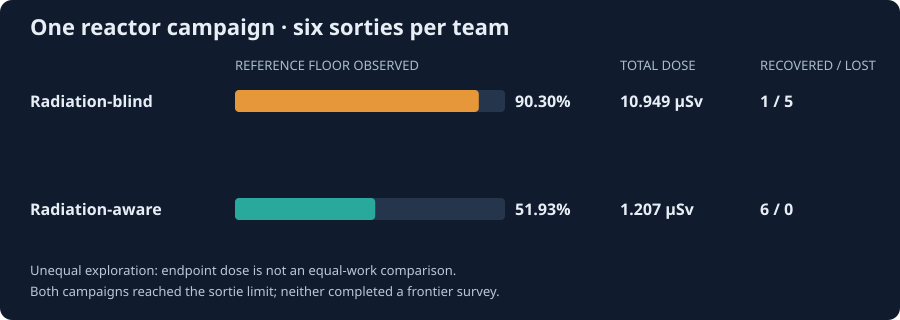

# Dougie-Sim

**Explore unknown radiation fields with a physically simulated quadruped.**
Dougie-Sim pairs a Unitree Go2 in MuJoCo with frontier exploration, online
Gaussian-process (GP) mapping and dose-aware route planning. A side-by-side
dashboard compares independent radiation-blind and radiation-aware teams.

[Run the demo](#reproduction-and-demo) · [Results](#results) ·
[How it works](#how-it-works) · [Documentation](docs/DOUGIE_INDEX.md)

## Results



*One illustrative reactor campaign with a 2 µSv-equivalent simulated lifetime
per robot. Both teams reached their six-sortie limit with incomplete surveys.
The teams explored different amounts, so their endpoint doses are **not an
equal-work comparison**. [Campaign data](docs/results/dougie_reactor_campaign_20261114.json) ·
[Protocol and limitations](docs/DOUGIE_CAMPAIGNS.md).*

The experimental `agenda` strategy is not the default. In a small two-layout
development holdout, results were mixed and included worker failures; no package
confirmed frontier exhaustion. A targeted follow-up on the difficult second
layout also favoured the baseline on both observation and dose. See the
[holdout and negative results](docs/DOUGIE_CAMPAIGN_AGENDA.md#completed-holdout-and-return-route-development).

An **earlier**, uncapped single reactor pair used a different GP profile: at the
first recorded ≥90% floor-observation crossing, actual doses were **6.7876 µSv
blind** and **3.8963 µSv aware**, with actual coverage of 90.19% and 90.27%.
Both stopped with unresolved frontiers. This is one development pair, not a
general performance estimate. [Historical results and figures](docs/DOUGIE_COMPARISON_RESULTS.md).

## How it works

- **Physical exploration:** a torque-driven Go2 walks in MuJoCo, building a
  support map from range observations. The paired comparison uses simulator
  ground-truth pose for both teams.
- **Radiation-aware planning:** a counting detector feeds a paged, windowed GP;
  predicted exposure influences routes and a return reserve. The blind planner
  receives no radiation information, while true simulated dose is recorded for both.
- **Multi-sortie campaigns:** each team keeps its own map and knowledge across
  robot deployments. Recovered routes can guide later robots; failed robots
  remain collision-visible obstacles. The default campaign strategy is `baseline`;
  `agenda` is opt-in.
- **Honest completion:** a survey finishes only when the planner confirms zero
  frontiers on three fresh scans. Blocked routes, failures, interruptions and
  sortie limits remain incomplete, regardless of coverage percentage.

The radiation field and lifetime thresholds are **synthetic dose-equivalent
proxies**, not calibrated hardware damage or measured Go2 tolerances. The
planner is a heuristic, not a guarantee of safety or an optimal tour. See
[radiation methods](docs/DOUGIE_RADIATION.md),
[windowed GP](docs/DOUGIE_WINDOWED_GP.md) and
[terrain qualification](docs/DOUGIE_TERRAIN_QUALIFICATION.md).

## Reproduction and demo

On an Apple Silicon Mac with Docker Desktop installed:

```bash
git clone --branch improve-navigation-efficiency https://github.com/DavidBatty95/Dougie-Sim.git
cd Dougie-Sim
./demo
```

The launcher builds the ARM64 runtime, downloads checksum-verified assets and
opens **http://localhost:8770**. The default is a reactor campaign with up to
six sorties, a 2 µSv-equivalent robot lifetime and a 1.6 µSv-aware planning
budget. These settings are illustrative and configurable.

```bash
./dougie-mac compare-status
./dougie-mac compare-stop
DOUGIE_COMPARE_WORLD=facility ./demo
DOUGIE_COMPARE_CAMPAIGN=0 ./demo  # independent uncapped comparison
```

For Linux or other graphics options, use `./dougie setup` followed by
`./dougie compare`; see the [comparison guide](docs/DOUGIE_COMPARISON.md).
The [Mac guide](docs/DOUGIE_MAC.md) covers the optional desktop, and the
[seed-study guide](docs/DOUGIE_SEED_STUDY.md) covers resumable batches.
Raw run output stays locally under `results/`; portable reports are in
[`docs/results/`](docs/results/README.md).

### Verify and regenerate

```bash
./dougie test
python3 scripts/check_dougie_docs.py
python3 scripts/render_campaign_overview.py --check
python3 scripts/publish_frontier_comparison.py --check
node scripts/test_comparison_metrics.cjs
```

Run `python3 scripts/render_campaign_overview.py` to regenerate the campaign
figure from its retained JSON. The historical figure publisher runs inside the
provided container. The latest full local Go2 suite passed **530 tests**;
remote CI is a separate check.

## Discussion and limitations

Single campaigns and small development holdouts do not establish consistent dose
improvement, complete exploration, safe hardware operation or validated
multilevel autonomy. Matched-progress comparisons must include actual coverage
crossings, dose and incomplete outcomes. The [documentation index](docs/DOUGIE_INDEX.md)
links the current methods, retained evidence and earlier development history.

## Software and attribution

The Go2 model is from `unitreerobotics/unitree_mujoco` (BSD-3-Clause); the
pretrained policy and observation contract are from `fan-ziqi/rl_sar`
(Apache-2.0). Pinned assets and upstream licenses are downloaded together.
Dougie is the quadruped sibling of [Geoff-Sim](https://github.com/DavidBatty95/Geoff-Sim).

[Licensing](LICENSES.md) · [Contributing](CONTRIBUTING.md) ·
[Security](SECURITY.md) · [History](docs/DOUGIE_HISTORY.md)
