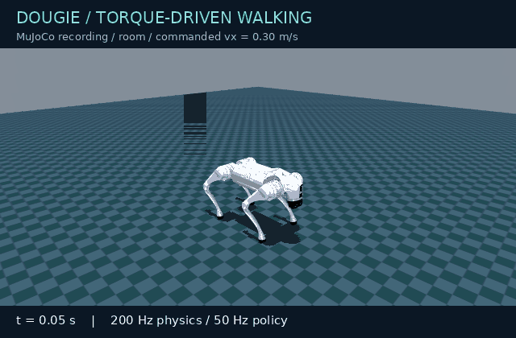
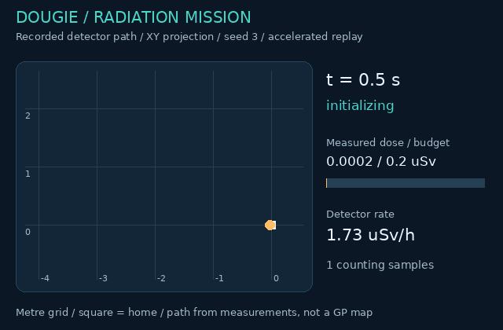
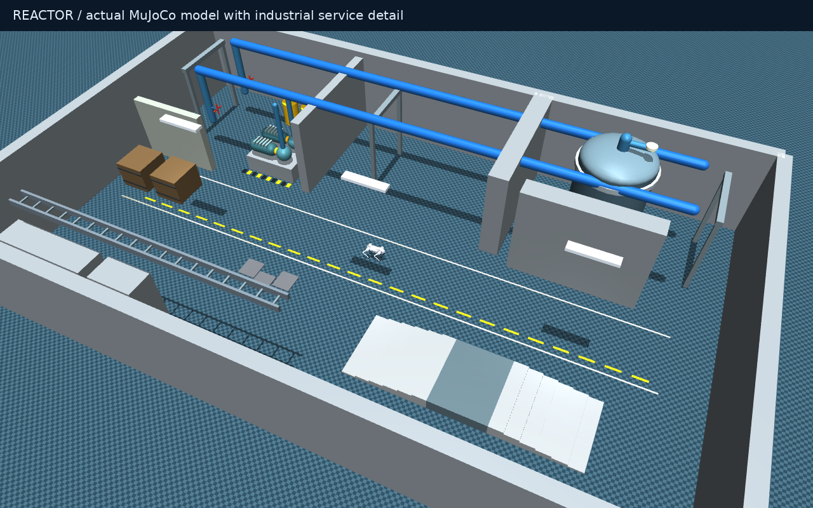
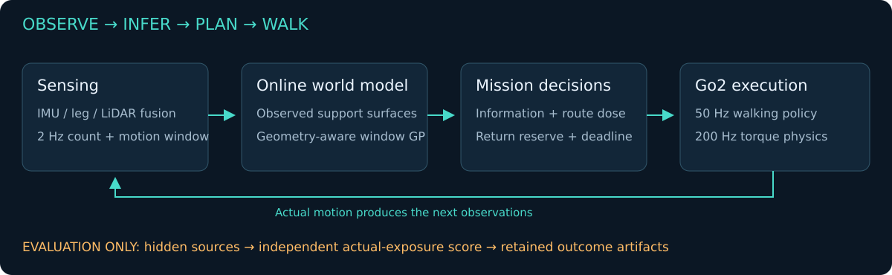

# Dougie-Sim


**Unitree Go2 · MuJoCo · ROS 2 Humble · Dose-constrained radiation mapping**

[](https://github.com/DavidBatty95/Dougie-Sim/actions/workflows/verification.yml)

[Quick start](#quick-start) · [Demo gallery](#recorded-demo-gallery) · [Run a mission](#run-a-radiation-mission) · [Results](#measured-results) · [Research](#research-and-design) · [Documentation](docs/DOUGIE_INDEX.md)

**Map an unknown facility while managing radiation exposure and retaining an
estimated return budget.** Dougie-Sim combines physical quadruped walking,
three-dimensional range sensing, a counting radiation detector, online Gaussian
process inference and dose-aware exploration in a reactor-themed environment.

Dougie is the quadruped sibling of [Geoff-Sim](https://github.com/DavidBatty95/Geoff-Sim).
It has an independent twelve-joint Go2 runtime and a pinned pretrained walking
policy. Geoff's source history and humanoid research remain available in the
[historical README](README-GEOFF.md).

**Evidence checkpoint — 7 October 2026:** the initial validation records 25 passing
tests and three radiation missions that returned within a 0.2 µSv budget in one
reactor layout. Physical simulation trials also crossed 6 cm stair risers and
2–4 cm floor plates. This is an initial integration and research baseline;
sensor-only autonomy, general dose safety and multi-floor coverage remain open.
[Read the measured scope](docs/DOUGIE_VALIDATION.md).

**Terrain update — [680 scored qualification trials](docs/DOUGIE_TERRAIN_QUALIFICATION.md):**
ordinary industrial stairs are **not qualified**. The tested 2 cm random-tile
distribution and 10° ramp courses passed 60/60 holdout repeats each. Earlier
6 cm stair completions included calf impacts or failed to repeat reliably;
they are demonstrations of traversal, not a validated operating envelope.

## Explore Dougie-Sim

| Capability | What runs today | Entry point |
|---|---|---|
| **Quadruped locomotion** | Free-floating Go2, twelve torque-controlled joints, 200 Hz physics / 50 Hz policy | `./dougie demo` |
| **Radiation mapping** | 2 Hz Poisson detector and bounded XYZ log-rate GP | `./dougie radiation` |
| **Dose-aware exploration** | Observed multi-height support, route exposure, return reserve and deadline checks | `./dougie radiation` |
| **Planar comparison** | Horizontal scans, SLAM Toolbox, Nav2 and frontier goals | `./dougie explore` |
| **Terrain qualification** | 52 profiles, contact-aware scoring and independent repeatability trials | `./dougie terrain-qualify` |
| **Reproducible evidence** | Seeded detector noise, source hashes, retained traces and independent exposure scoring | [Validation](docs/DOUGIE_VALIDATION.md) |

## Recorded demo gallery

| Go2 walking in MuJoCo | Radiation mission data replay |
|---|---|
|  |  |

**Left:** a new six-second physics run, commanded at 0.3 m/s with a following
camera; the command is not a measured speed. **Right:** an accelerated XY replay
of the recorded seed-3 mission's detector samples and planner states. The line is
the sampled path, not a GP field or a screen recording. The two panels show
separate runs. [Media provenance, portable replay data and regeneration](docs/DOUGIE_MEDIA.md).



The reactor image is a model render. The animated title and architecture below
are schematics. Visual previews illustrate the system; scored claims come from
the [portable evidence report](docs/results/dougie_initial_20261007.json).

## Quick start

### Requirements

- Linux with Docker Engine and **Docker Compose v2 or newer**; the container
  provides ROS 2 Humble, MuJoCo and CPU PyTorch.
- Internet access for the first build and checksum-verified public assets.
- X11/XWayland and a valid `DISPLAY` for interactive MuJoCo/RViz windows.
  Headless simulation needs no display server or GPU.
- Permission to run Docker and write the working checkout. Host ROS installation
  and recursive private submodule checkout are not needed for the Go2 profile.

```bash
git clone https://github.com/DavidBatty95/Dougie-Sim.git
cd Dougie-Sim
./dougie setup
./dougie radiation --dose-budget 2 --duration 600
```

Setup downloads the public Go2 model/meshes and `rl_sar` Go2 `robot_lab` policy
from immutable commits, verifies SHA-256 checksums, caches them under `.dougie/`,
then builds `dougie-sim:humble`. See the [asset manifest](config/dougie_assets.json)
and [attribution](docs/DOUGIE_SIM.md#attribution).

For a display-free first mission, replace the last command with:

```bash
./dougie radiation --headless --fast --dose-budget 0.2 --duration 180 --seed 3
```

`--duration` is a simulated-time limit. `--fast` requires `--headless`, removes
wall-clock pacing and disables ROS publication. It does not guarantee a particular
speedup. Omit `--fast` for paced runs with ROS topics.

## Run a radiation mission

The default field now contains **point-source hotspots and localized leaks**.
Use `--show-sources` for red hotspot/amber leak markers, or omit it to display
only the learned GP map. [Source locations, strengths and configuration](docs/DOUGIE_SOURCES.md).

```bash
# Interactive reactor mission, default Poisson GP:
./dougie radiation --source-profile hotspots-and-leaks --show-sources --dose-budget 2 --rate-limit 100 --duration 600

# Repeatable detector-noise seed, no display or DDS:
./dougie radiation --headless --fast --dose-budget 0.2 --duration 180 --seed 3

# Comparison likelihood and smaller GP dictionary:
./dougie radiation --headless --fast --gp-likelihood gaussian --gp-capacity 64 --duration 180
```

| Option | Default | Meaning |
|---|---:|---|
| `--dose-budget` | `2` | Cumulative exposure budget in **µSv** |
| `--rate-limit` | `100` | Measured rate threshold in **µSv/h** |
| `--duration` | `600` | Maximum simulated mission time in seconds |
| `--seed` | `1` | Detector-noise seed; does not randomize facility geometry |
| `--gp-capacity` | `128` | Maximum inducing dictionary size |
| `--gp-likelihood` | `poisson` | Poisson/Laplace inference or `gaussian` log-Gaussian approximation |
| `--source-profile` | `hotspots-and-leaks` | Combined emitters, `hotspots`, `leaks`, or the original `baseline` |
| `--source-config` | Built-in JSON | Alternative source file inside the checkout |
| `--show-sources` | Off | Diagnostic true-source markers; never supplied to autonomy |
| `--headless` | Off | Suppress the MuJoCo viewer |
| `--fast` | Off | Headless unpaced physics without ROS |

### What to expect

The interactive demo now opens **RViz in a separate process**. MuJoCo runs
physics without a viewer. RViz shows the diagnostic world geometry, articulated
Go2 collision shapes, learned GP volume, planned/travelled paths and mission
state. See [rendering performance and measurements](docs/DOUGIE_PERFORMANCE.md).

1. Go2 settles into stance, then the mission uses observed support surfaces to
   select routes. It does not receive hidden source positions or a facility map.
2. A counting detector integrates along actual motion and reports every 0.5 s.
   Its samples update a sparse GP at XYZ coordinates.
3. Candidate routes trade coverage and uncertainty against travel and estimated
   dose. Admission includes a known-route return estimate and a budget reserve.
4. High measured rate, budget use or the return-time allowance can trigger retreat.
   Stale sensing/planning gates motion; a return can still fail.
5. The run writes its measurements, predictions and independently scored outcome
   into `results/dougie/radiation_*/`. Ctrl+C stops the session.

In the viewer, colored spheres show the **learned GP mean**, not the hidden true
field. A predicted map can look complete even where uncertainty is high; inspect
the sampled height range and uncertainty before interpreting it.

The units are synthetic dose-equivalent proxies, not a calibration of Go2
electronics damage. MuJoCo handles mechanics; a separate attenuation-only field
model supplies radiation observations. [Full methods and assumptions](docs/DOUGIE_RADIATION.md).

## Walking, exploration and ROS

```bash
./dougie worlds
./dougie demo --world flat --vx 0.3 --duration 30
./dougie demo --world room
./dougie explore --world office --duration 300
./dougie explore --world office --people 1 --duration 300
```

`demo` and `explore` open RViz, with MuJoCo physics running without a viewer.
Both accept `--headless`.
The zero-command demo balances until it receives commands and can drift.
Exploration uses planar SLAM/Nav2; completed office coverage is not yet established.
Moving people are simplified kinematic capsules, not validated crowd behavior.

| Scene | How to select it | Purpose |
|---|---|---|
| `flat` | `demo --world flat` | Open-plane policy response |
| `room` | `demo --world room` | 12 × 12 m enclosure, scans and manual commands |
| `office` | `explore --world office` | Partitions, furniture and planar frontiers |
| `reactor` | `radiation` | Shielding, vessel, drums, floor plates and inspection deck |
| `stairs` | `terrain-test` | Legacy small-riser completion demonstration; use `terrain-qualify` for qualification |

`worlds` lists all scenes; `demo` and `explore` accept only `flat`, `room`, or
`office`. Reactor and stair runs have their dedicated entry points.

### Send velocity commands

Start `./dougie demo --world room`. In a second terminal:

```bash
./dougie shell
# Inside the ROS-enabled container shell:
ros2 topic pub --rate 10 /cmd_vel geometry_msgs/msg/Twist '{linear: {x: 0.2}, angular: {z: 0.0}}'
```

Stopping publication triggers the **0.5-second command watchdog**. Use one command
source at a time. Radiation mode owns motion and ignores external `/cmd_vel`;
ordinary exploration owns its navigation commands. The ordinary demo's basic
scan-based forward stop is not Geoff's human-aware planner.

### Inspect live topics

During a paced ROS-enabled session, enter `./dougie shell` and run:

```bash
ros2 topic list
ros2 topic hz /scan
ros2 topic echo --once /odom
# During a radiation session without --fast:
ros2 topic echo --once /radiation/status
ros2 topic echo --once /radiation/measurement
```

| Interface | Content |
|---|---|
| `/clock`, `/tf` | Simulation time and transforms |
| `/odom`, `/imu`, `/joint_states` | Simulator pose, IMU and twelve-joint state |
| `/scan` | Ideal horizontal raycast scan |
| `/cmd_vel` | Ordinary-demo velocity input / ordinary-exploration commands |
| `/radiation/measurement`, `/radiation/status` | JSON in `std_msgs/String` |
| `/radiation/gp_map` | `sensor_msgs/PointCloud2`: XYZ, mean, upper rate and log-rate uncertainty |

DDS defaults to loopback-only domain **43**. `./dougie shell` shares that
configuration; host tools need matching DDS settings.

## Architecture



- **Physics and policy:** the pinned policy maps a 45-value observation to twelve
  actions; PD control applies joint torques. The free base is integrated by
  MuJoCo with no execution-time teleportation or stabilizing tether.
- **Observed terrain:** 3-D ray returns and estimated surface normals create a
  multi-height support graph. Unknown support is not traversable; steps over
  7.5 cm and known body-height obstacles are rejected.
- **Radiation inference:** a positive log-rate field uses a Matérn-3/2 ARD kernel
  and streaming sparse Laplace updates for Poisson counts. The dictionary is
  capped; unobserved heights retain uncertainty.
- **Planning:** route exposure uses upper GP rates, measured cumulative counts,
  return routes, a 15% budget reserve and a dwell allowance. This is a heuristic,
  not a proof of optimal coverage or probabilistic dose safety.
- **Concurrency:** a background worker processes detached observations while
  physics continues; the main loop checks sensor and plan freshness.

**Pose is simulator ground truth.** The ideal range scanner is not a reproduction
of the Go2 L1 LiDAR. This baseline isolates mapping/planning integration; replacing
ideal pose and sensing is a research milestone. [Architecture and source boundaries](docs/DOUGIE_SIM.md).

## Outputs and reproducibility

Ordinary sessions and radiation missions write under `results/dougie/`.
For radiation, keep the whole run directory:

| Artifact | What to inspect |
|---|---|
| `run_config.json` | CLI settings, source hashes and asset-manifest identity |
| `source_scenario.json` | Selected point-source profile and resolved simulator configuration |
| `measurements.jsonl` | Time, XYZ, counts, integration window, estimated rate and dose |
| `trace.jsonl` | Mission states, observed coverage and planning timings |
| `radiation_summary.json` | Outcome, estimated/actual exposure, return and sampled heights |
| `radiation_map_3d.npz` | XYZ queries, mean/upper rates and log-rate uncertainty |
| `gp_posterior.npz` | Inducing coordinates, posterior and kernel parameters |
| `observed_geometry.npz` | Range hits and sampled observed-free voxels |
| `evaluator_field.json` | Post-run hidden field for evaluation, never a planner input |

Compare runs using actual dose, return outcome, geometric coverage and field error
together. A larger coverage proxy alone can conceal a budget exceedance or failed
return. Seeds vary counting noise in the same layout; record configuration/source
hashes and retain failed runs. [Report reproduction](docs/DOUGIE_VALIDATION.md#reproduce-the-portable-report).

## Measured results

The frozen initial Poisson cohort used a **0.2 µSv budget**, **100 µSv/h rate
threshold**, **128 inducing points** and **180 s maximum** in one reactor scene.
Select `--source-profile baseline` to reproduce that field; the new default
hotspot/leak scenario has different source positions and concentrations.

| Detector seed | Return time (s) | Actual dose (µSv) | Observed surface proxy (m²) | Outcome |
|---|---:|---:|---:|---|
| 1 | 123.20 | 0.08283 | 131.81 | Returned upright, within budget |
| 2 | 149.26 | 0.11124 | 124.94 | Returned upright, within budget |
| 3 | 135.23 | 0.10429 | 133.56 | Returned upright, within budget |

Home tolerance was 0.4 m. These three noise repeats are not a general reliability
study. Surface area is a discretized observed-geometry proxy, not full facility
coverage. Sensor heights were approximately **0.39–0.46 m**, so XYZ prediction
does not establish volumetric radiation reconstruction.

| Separate qualification | Recorded finding | Scope |
|---|---|---|
| Software/interfaces | 25 tests passed, including real-DDS radiation publication | Dated initial checkpoint |
| Small stairs | Six ascent + six descent contacts, 6 cm risers, 36 cm deck | Heading-guided course, not autonomous stair discovery |
| Uneven floor | Three 2–4 cm plates contacted, upright traversal | Dedicated course |
| Poisson GP, capacity 128 | 0.245 ms update p95; 9.48 ms / 1,000-query batch | Synthetic benchmark, host-dependent |
| GP accuracy, same benchmark | 0.439 log1p-rate RMSE; 36.54 µSv/h raw-rate RMSE | Substantial hotspot error remains |

The small-stair/plate rows above preserve the initial demonstrations. The
[later terrain assessment](docs/DOUGIE_TERRAIN_QUALIFICATION.md) supersedes any
interpretation of them as reliable or clean terrain qualification.

[Full validation and caveats](docs/DOUGIE_VALIDATION.md) · [Machine-readable evidence](docs/results/dougie_initial_20261007.json)

## Research and design

The central question is **how much useful geometry and radiation information a
walking robot can acquire before its estimated exposure and return costs consume
the mission budget**. Source seeking, map reconstruction and safe return are
different objectives; Dougie evaluates them through a combined mission baseline.

| Research foundation | Connection to Dougie | Implementation boundary |
|---|---|---|
| [West et al., Scientific Reports 2021](https://doi.org/10.1038/s41598-021-93474-4) | Irregular low-count radiation observations, positive log fields, Poisson likelihood and Matérn kernels | Real reactor surveys on Jackal; Dougie uses a synthetic field and bounded online approximation |
| [Stephens et al., Autonomous Robots 2024](https://doi.org/10.1007/s10514-024-10172-6) | GP-informed hazard exploration and return reasoning | SafeEstMDP is a future comparator; current routing is heuristic |
| [Chen, Liu and Khardon, POAM, RSS 2024](https://arxiv.org/abs/2406.03669) | Computationally bounded online mapping and nonstationary models | Dougie does not implement POAM's attentive kernel, inducing replacement or variational EM |
| [Sudha, Jose and Coates, ECMR 2025](https://arxiv.org/abs/2507.13053) | Streaming GP mapping while moving | Their static 2-D setting and growing inducing set differ from Dougie's capped XYZ model |

The [research reading guide](docs/DOUGIE_RESEARCH.md) connects the papers to source
files, explains rate versus cumulative dose, and defines proposed comparisons.
The [methods review](docs/DOUGIE_RADIATION.md#research-findings-and-design-choices)
records inspection depth and access limitations. This is a targeted research
synthesis, not a claim to reproduce or outperform the cited systems.

### Next research milestones

1. **Matched baselines:** radiation-blind frontiers, mean-only risk and upper-bound
   risk under matched sensing and compute; report dose, coverage and return failures.
2. **Field generalization:** held-out source/shield layouts, sharp-hotspot error,
   uncertainty calibration and alternative kernels.
3. **Motion-aware reserves:** measured travel-time distributions and larger-riser
   qualification before multi-storey missions.
4. **Onboard sensing:** LiDAR/inertial/leg odometry and pose-error propagation.
5. **Volumetric evidence:** independent sampling at multiple detector heights.
6. **Radiation fidelity:** transport-generated reference fields and calibrated
   detector response.

These are proposed gates, not completed capabilities. The inherited
[Geoff literature review](docs/literature_review/README.md) remains a humanoid
research reference; its results and manipulation capabilities do not transfer to Go2.

## Verification and development

```bash
./dougie test
./dougie terrain-test
./dougie terrain-qualify --suite matrix --workers 6
./dougie terrain-qualify --suite repeatability --workers 6
./dougie benchmark-gp
python3 scripts/check_dougie_docs.py
```

An ordinary ROS smoke run and artifact check:

```bash
./dougie demo --headless --duration 8
python3 scripts/check_dougie_run.py
```

Default CI builds the Go2 image and checks policy/model ordering, physical
standing/walking/turning, scans, watchdogs, frontier planning, detector statistics,
GP posteriors, dose-return behavior, terrain and ROS interfaces. The active profile
does not build inherited G1 ROS packages.

`terrain-qualify` records stability, contacts, penetration, joint limits,
landing/corridor witnesses, settling and repeated outcomes. Its default exit
status reports successful evidence collection; add `--require-qualified` to
fail the command when a robot trial fails qualification. `terrain-test` retains
the original completion-only demonstration.

### Troubleshooting

| Symptom | What to check |
|---|---|
| `docker compose` unavailable / Docker denied | Install Compose v2+, ensure the daemon is running and your user has Docker access |
| Missing model or policy | Run `./dougie setup`; inspect download/checksum errors and network access |
| `DISPLAY is unset` | Use `--headless`, or launch from a graphical session with its existing display environment |
| X11 authorization failure | Pass the session's existing `DISPLAY` and valid `XAUTHORITY`; if required, authorize the container user with `xhost +si:localuser:$(id -un)` |
| No radiation topics | Omit `--fast`; inspect from `./dougie shell` in the matching DDS domain |
| Robot stands still | Default demo velocity is zero; send `/cmd_vel` or set `--vx`; exploration can also wait for map/planner readiness |
| `--world reactor` rejected | Use `./dougie radiation`; `demo`/`explore` accept only flat, room and office |
| Return or budget failure | Inspect summary and trace; an estimated reserve is not a guarantee against falls, blockage or model error |

Only run one interactive command-owning ROS session per domain. Ctrl+C stops the
session and its child processes. For display access details, use the existing
session credentials rather than disabling X server access control globally.

## Repository map

| Path | Responsibility |
|---|---|
| [`dougie`](dougie), [`scripts/dougie_cli.py`](scripts/dougie_cli.py) | Daily commands and container launch |
| [`dougie_sim/simulation.py`](dougie_sim/simulation.py) | Model construction, policy adapter, physics and ideal range sensors |
| [`dougie_sim/radiation.py`](dougie_sim/radiation.py), [`dougie_sim/gp.py`](dougie_sim/gp.py) | Field/detector model and bounded inference |
| [`dougie_sim/terrain.py`](dougie_sim/terrain.py), [`dougie_sim/dose_planner.py`](dougie_sim/dose_planner.py) | Observed support and dose-aware decisions |
| [`dougie_sim/radiation_run.py`](dougie_sim/radiation_run.py) | Radiation mission lifecycle, viewer and artifacts |
| [`dougie_sim/ros_bridge.py`](dougie_sim/ros_bridge.py), [`dougie_sim/explore.py`](dougie_sim/explore.py) | ROS interfaces and planar comparison |
| [`config/`](config/), [`docker/Dockerfile.dougie`](docker/Dockerfile.dougie) | Verified assets, ROS settings and container dependencies |
| [`tests/dougie/`](tests/dougie/) | Go2-specific validation |
| [`docs/DOUGIE_INDEX.md`](docs/DOUGIE_INDEX.md) | Active guides, methods, evidence and media |
| [`README-GEOFF.md`](README-GEOFF.md), [`ros2_ws/`](ros2_ws/), [`vendor/`](vendor/) | Inherited Geoff source and research history |

## Attribution and contributing

Dougie preserves Geoff-Sim history at
`d1d54ff974e44546e260d3ccf6e3cb1f8f3a7568`. The Go2 model comes from
`unitreerobotics/unitree_mujoco` (BSD-3-Clause); the policy and observation contract
come from `fan-ziqi/rl_sar` (Apache-2.0). Assets and their upstream licenses are
downloaded together. Existing package notices remain in force.

[Attribution details](docs/DOUGIE_SIM.md#attribution) · [Licensing inventory](LICENSES.md) ·
[Contributing](CONTRIBUTING.md) · [Security scope](SECURITY.md)

For Go2 changes, start with the commands above and include configuration, source
identity and measured outcomes when reporting experiments. No blanket relicensing
of the inherited repository is implied.
