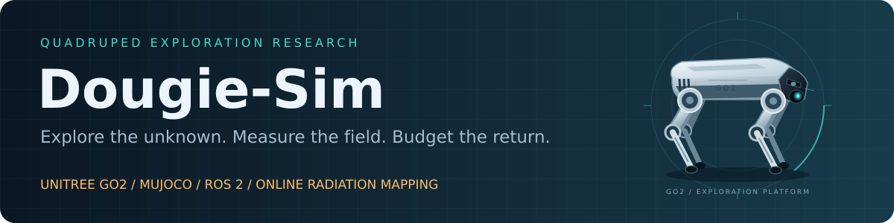
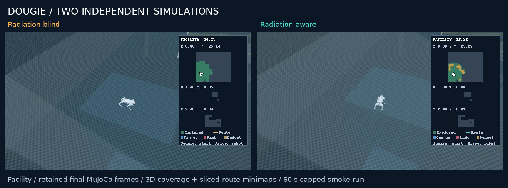
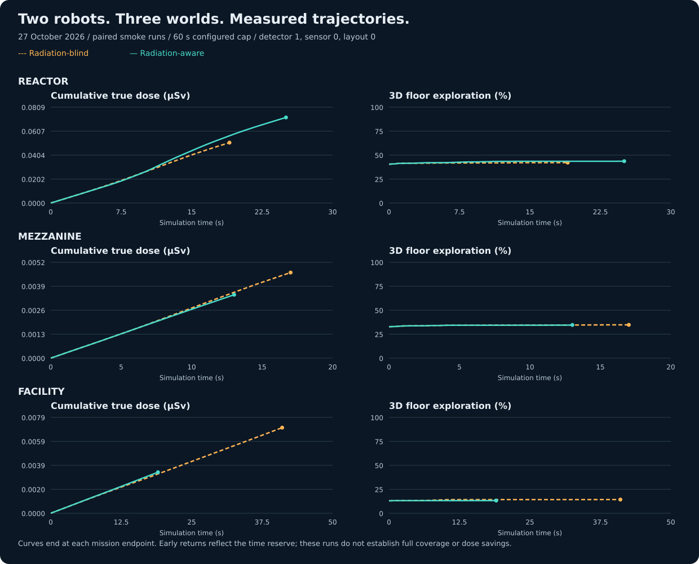
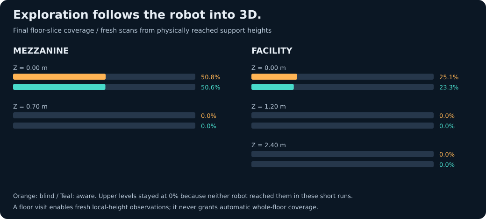
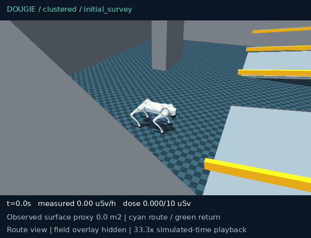
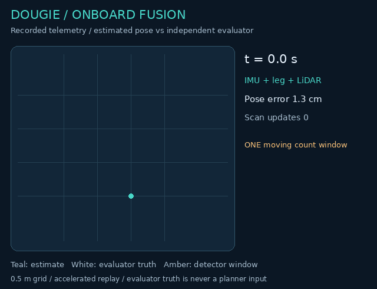

# Dougie-Sim



**Unitree Go2 · MuJoCo · Onboard sensor fusion · Radiation-aware exploration · Live comparison dashboard**

[](https://github.com/DavidBatty95/Dougie-Sim/actions/workflows/verification.yml)

[Quick start](#quick-start) · [Live comparison](#run-a-radiation-mission) · [Current results](#measured-results) · [Recorded missions](#recorded-demo-gallery) · [How it works](#architecture) · [Documentation](docs/DOUGIE_INDEX.md)

**Explore an unknown environment. Estimate its radiation field. Compare the cost of awareness.**

Dougie-Sim is a physical quadruped simulation for investigating radiation-aware
exploration. A torque-driven Go2 builds geometry and radiation estimates from
simulated onboard measurements, selects routes over observed support, and tracks
exposure alongside exploration progress.

Run radiation-blind and radiation-aware Dougie **side by side** with live video,
dose/time and exploration/time graphs, and floor-sliced route minimaps—all in a browser.

## Current progress

**Verified locally on 27 October 2026.**

| Checkpoint | Current evidence |
|---|---|
| **355 tests passing** | Full Go2 software, physics and interface suite: `./dougie test` |
| **3 comparison worlds** | Reactor, mezzanine and full-height facility |
| **6/6 clean returns** | Latest three paired smoke runs; all six recorded zero non-foot contact impulse |
| **Physical 3D coverage** | Unvisited upper levels remain at **0%**; fresh observations count after physical arrival |
| **Continuous video feeds** | Separate rendering processes, configurable 1–60 FPS target, independent graph updates |
| **Recorded vertical milestone** | Explicit 8° mezzanine upstairs/downstairs/home mission: **25.76 m**, **0.2747 µSv** |

The smoke cohort uses a 60-second configured cap and one paired seed per world.
The recorded vertical milestone is a separate, documented mission.
[Current results and provenance](docs/DOUGIE_COMPARISON_RESULTS.md) ·
[Recorded mission evidence](docs/results/dougie_loop_budget_baseline_20261026.json)



*Actual final MuJoCo frames from the latest facility pair, composed for this README.
The live dashboard adds live time-series graphs and mission readouts below the feeds.*

## Quick start

### Requirements

- Linux, Docker Engine and **Docker Compose v2+**.
- Internet access for the initial image build and checksum-verified public assets.
- A browser for the comparison dashboard. Offscreen rendering supports NVIDIA,
  DRM/DRI and software graphics; X11 is only needed for desktop MuJoCo/RViz viewers.
- Docker access and write permission to the checkout. Host ROS installation is not required.

```bash
git clone https://github.com/DavidBatty95/Dougie-Sim.git
cd Dougie-Sim
./dougie setup
./dougie compare --world reactor
```

Open **http://localhost:8765**.

Setup downloads the Go2 model and pretrained walking policy from pinned upstream
commits, verifies SHA-256 checksums, caches assets under `.dougie/`, and builds the
simulation image. [Asset manifest](config/dougie_assets.json) ·
[Attribution](docs/DOUGIE_SIM.md#attribution)

## Run a radiation mission

### Side-by-side comparison

```bash
# Default: survey until completion or a reported exploration/navigation limit.
./dougie compare --world reactor

# Multilevel worlds with automatically sliced minimaps:
./dougie compare --world mezzanine --feed-fps 30
./dougie compare --world facility --feed-fps 30

# Optional fixed-time experiment:
./dougie compare --world facility --duration 600 --seed 1

# CPU graphics fallback:
./dougie compare --graphics software
```

| Dashboard feature | What it shows |
|---|---|
| **Two independent simulations** | Matched world, policy, detector/sensor seeds and planner timing |
| **Dose graph** | Integrated true simulated exposure along each actual trajectory, in µSv |
| **Exploration graph** | Fixed-reference floor coverage with physical 3D arrival checks |
| **Route minimaps** | Actual travelled routes, starting positions and robot headings |
| **Elevation slices** | Current level expands; other floors and the intermediate landing remain visible |
| **Survey outcomes** | Complete, radiation-limited, navigation-limited, time-limited or interrupted |

**Minimap colours:** green = explored; blue = known admissible support;
red = predicted radiation-blocked; amber = dose-budget limited; grey = unknown/unclassified.

Seeing upstairs from below **does not explore it**. Dougie must physically reach
that elevation before fresh scans there count. Ramps accumulate coverage during
the climb; arriving on a floor does not grant automatic whole-floor coverage.

The default `--duration 0` removes the demo time cap. Both robots target full
survey, while radiation-aware Dougie may return earlier when radiation or dose
constraints exclude further work. Navigation and mapping limits are reported
separately, without turning an incomplete survey into “100%”.

Video defaults to a **15 FPS target**; `--feed-fps` accepts 1–60. Actual delivery
depends on simulation and rendering load. Final views stay open until **Ctrl+C**.
Use `--exit-on-complete` for automation or `--port 8766` for another dashboard.

[Full comparison guide, metrics and saved artifacts](docs/DOUGIE_COMPARISON.md)

### Single-robot radiation mapping

```bash
# Interactive mission with the learned radiation field in RViz:
./dougie radiation --world reactor --duration 600 --dose-budget 2

# Reproducible display-free run:
./dougie radiation --headless --fast --duration 90 --dose-budget 2 \
  --seed 3 --sensor-seed 0 --fixed-plan-delay .5 --require-clean
```

Radiation mode defaults to fused localization, a geometry-aware GP, moving-window
Poisson detector likelihood, and support/risk-checked smooth paths. `--fast`
requires `--headless` and disables ROS publication.

| Setting | Default | Purpose |
|---|---|---|
| `--dose-budget` | `2` µSv | Cumulative exposure allowance |
| `--rate-limit` | `100` µSv/h | Radiation-rate admission threshold |
| `--localization` | `fused` | IMU/leg/LiDAR pose estimation |
| `--gp-mode` | `geometry` | Observed-surface-aware radiation inference |
| `--detector-likelihood` | `window` | Integrate counts across motion within each sampling window |
| `--path-mode` | `smooth` | Checked smooth execution over observed support |

`--show-sources` adds **diagnostic** source markers to the operator view; source
coordinates are not supplied to navigation. `--localization ground-truth` is an
explicit diagnostic comparator, rather than the default mission mode.

[Source configuration](docs/DOUGIE_SOURCES.md) · [Radiation methods](docs/DOUGIE_RADIATION.md) ·
[Onboard mission guide](docs/DOUGIE_ONBOARD_MISSION.md) · [Graphics options](docs/DOUGIE_PERFORMANCE.md)

## Measured results

### Latest paired comparison — 27 October 2026

The current publication includes **all six runs**, using the corrected
`physically_reached_3d_floor_v2` coverage metric. Settings: detector seed **1**,
sensor seed **0**, layout seed **0**, **2 µSv** budget, **100 µSv/h** threshold,
and a **60 s configured cap** including return reserve.



| World | Blind dose (µSv) | Aware dose (µSv) | Blind explored | Aware explored | Physical outcome |
|---|---:|---:|---:|---:|---|
| Reactor | 0.050949 | 0.072218 | 42.15% | 43.64% | Both returned cleanly |
| Mezzanine | 0.004635 | 0.003433 | 34.73% | 34.62% | Both returned cleanly |
| Facility | 0.007024 | 0.003365 | 14.25% | 13.21% | Both returned cleanly |

These are **short integration/smoke results**, with time-reserve-limited surveys.
Curves stop at each mission endpoint; the robots need not use the entire cap.
Different coverage and mission durations mean these totals alone do not establish
a radiation-awareness advantage at matched work.

### Exploration that respects floor transitions



The upstairs slices stay at **0%** in these short ground-floor runs—even when
LiDAR can glimpse elevated surfaces. The minimap, graphs and completion check all
use the same physical-arrival-aware coverage mask.

[Full per-run table](docs/DOUGIE_COMPARISON_RESULTS.md) ·
[Portable time-series and source identities](docs/results/dougie_comparison_20261027.json) ·
[Figure provenance](docs/media/dougie/comparison-manifest.json)

## Recorded demo gallery

### Upstairs, downstairs, home — 8° mezzanine milestone

| Actual Go2 physics recording | Pose estimation and detector-window telemetry |
|---|---|
|  |  |

The **26 October** regression completed its strict vertical round trip in
**275.585 s**, travelling **25.755 m** with **0.274697 µSv** actual exposure,
**0.1071 m** true home error and **zero non-foot contacts**. The walking policy and
navigation use simulated onboard measurements. The left panel is accelerated
MuJoCo footage; the right is accelerated telemetry from the same mission.

This demonstrates the explicit **8° mezzanine configuration**, rather than
qualifying every slope or the full-height facility. It is a separate navigation
milestone, not one of the new blind/aware comparison trials.

[Recorded-run evidence](docs/results/dougie_loop_budget_baseline_20261026.json) ·
[Media provenance and regeneration](docs/DOUGIE_MEDIA.md#navigation-refresh--26-october-2026)

<details>
<summary><strong>More recorded milestones and development evidence</strong></summary>

- [Facility intermediate landing and clean return](docs/DOUGIE_MEDIA.md#facility-intermediate-return--26-october-2026): independently witnessed 1.2 m landing traversal; full 2.4 m onboard completion remains a development target.
- [Terrain qualification](docs/DOUGIE_TERRAIN_QUALIFICATION.md): 680 scored trials, with contact and repeatability checks.
- [SLAM and localization qualification](docs/DOUGIE_SLAM_QUALIFICATION.md): scenario-specific cohorts, calibration and retained results.
- [Navigation recovery development](docs/DOUGIE_NAVIGATION_RECOVERY.md): support fusion, checkpoints, registration and bounded-resource experiments.
- [Stance and stop-transition experiments](docs/DOUGIE_STANCE_RECOVERY.md): controller comparisons and their measured scope.
- [Earlier ideal-pose full-height comparisons](docs/DOUGIE_FULLHEIGHT_RESULTS.md): distinct historical autonomy configuration.
- [Complete media catalogue](docs/DOUGIE_MEDIA.md) and [initial validation archive](docs/DOUGIE_VALIDATION.md).

</details>

## Architecture

**Measurements → estimated pose → observed terrain and radiation → admitted route → physical Go2 motion.**

| Component | Current implementation |
|---|---|
| Physics and locomotion | Free-floating Go2, twelve torque-controlled joints, 200 Hz physics and 50 Hz pretrained policy |
| Onboard sensing | Noisy body-frame LiDAR, IMU, joint encoders and foot-force measurements |
| Localization | IMU/leg estimation, quality-gated registration and pose-graph corrections |
| Mapping | Multi-height support geometry and bounded geometry-aware GP radiation estimates |
| Planning | Connected observed routes, exposure forecasts, return reserve and systematic survey viewpoints |
| Display | Independent offscreen renderers, MJPEG feeds, sliced minimaps and live graphs |
| Evaluation | True trajectory/dose, physical floor-arrival checks and explicit mission outcomes |

### What the robot knows

Default route selection uses **simulated onboard observations and estimated pose**.
It receives neither a preloaded environment map nor hidden radiation-source locations.
Robot geometry, sensor calibration, the pretrained walking policy, inference
priors and configured navigation limits are available in advance; the selected
world also determines the terrain-processing profile.

The **operator/evaluator** uses simulator truth for the reference minimap,
actual-dose scoring, physical floor visitation and exploration percentages.
The current **100% coverage termination trigger is evaluator-based**, and physics
failure detection also uses simulator state. Thus the current system is
onboard-driven exploration with ground-truth evaluation—not a claim that every
part of the demonstration, including completion detection, is onboard-only.

[Architecture and source boundaries](docs/DOUGIE_SIM.md) ·
[Comparison contract](docs/DOUGIE_COMPARISON.md#comparison-contract)

## Walking, exploration and ROS

```bash
./dougie worlds
./dougie demo --world flat --vx 0.3 --duration 30
./dougie demo --world room
./dougie explore --world office --duration 300
```

`demo` and `explore` use RViz and accept `--headless`. The default demo command is
zero velocity; it balances until commanded. `explore` is the separate planar
SLAM/Nav2 profile, while `compare` and `radiation` use the 3D radiation mission.

| World | Entry point | Environment |
|---|---|---|
| `reactor` | `compare` / `radiation` | Vessel, shielding, service aisles and inspection deck |
| `mezzanine` | `compare` / `radiation` | Raised gallery and two access ramps |
| `facility` | `compare` / `radiation` | Overlapping storeys, intermediate landing and switchback ramps |
| `flat`, `room` | `demo` | Walking, standing and manual control |
| `office` | `explore` | Planar mapping and frontier navigation |
| Terrain courses | `terrain-qualify` | Contact-aware traversal and repeatability assessment |

For ROS inspection during a paced radiation session:

```bash
./dougie shell
# Inside the container:
ros2 topic list
ros2 topic echo --once /radiation/status
ros2 topic echo --once /radiation/measurement
```

ROS-enabled sessions use loopback-only DDS domain **43** by default. The browser
comparison runs isolated workers without ROS publication. Radiation mode owns
its motion commands; ordinary demo teleoperation uses `/cmd_vel` and a 0.5 s watchdog.

## Outputs and reproducibility

Runs are saved under `results/dougie/`. Keep the full run directory when comparing
experiments; configurations record source and asset identities.

| Artifact | Contents |
|---|---|
| `comparison_config.json` | Matched worker commands, seeds, protocol and coverage definition |
| `blind/`, `aware/` | Independent mission artifacts and logs |
| `comparison.jsonl` | Simulation time, true dose, coverage and survey outcome |
| `survey_report.json` | Final coverage, physically reached elevations and termination reason |
| `coverage_reference.npz`, `minimap_final.npz` | Reference floor samples, credited cells, admission classes and route rasters |
| `run_config.json`, `radiation_summary.json` | Runtime settings, identities and physical outcome |
| `measurements.jsonl`, `trace.jsonl` | Detector observations and planning decisions |
| `frame.jpg`, `stream_performance.json` | Latest rendered view and measured rendering statistics |

Regenerate the published comparison graphs from the portable data:

```bash
docker compose run --rm -T dougie-sim python3 scripts/publish_dougie_comparison.py
```

[Detailed artifact guide](docs/DOUGIE_COMPARISON.md#saved-results) ·
[Media provenance](docs/DOUGIE_MEDIA.md) · [Current portable report](docs/DOUGIE_COMPARISON_RESULTS.md)

## Research and design

The central question is **how much useful exploration a walking robot can achieve
for a given radiation exposure while retaining an estimated route home**.

The implementation combines low-count Poisson radiation observations, bounded
Gaussian-process inference, observed support geometry and dose-aware route
admission. [Research reading guide](docs/DOUGIE_RESEARCH.md) ·
[Radiation models and assumptions](docs/DOUGIE_RADIATION.md)

### Next milestones

1. **Matched-work evaluation:** expand blind/aware trials across seeds and layouts,
   comparing dose at equal coverage as well as final exposure and return outcome.
2. **Longer multilevel surveys:** extend physical coverage and repeatable onboard
   returns beyond the currently demonstrated configurations.
3. **Strictly onboard completion:** derive survey termination from observed
   frontiers and remove world-dependent autonomy configuration.
4. **Field and terrain generalization:** held-out source/shield layouts, calibrated
   uncertainty, and further contact-aware terrain qualification. Industrial stairs
   remain a development target.

Radiation values are simulated dose-equivalent proxies in µSv, not a calibration
of robot electronics damage. The platform is a research simulation, with
scenario-specific evidence rather than a deployment qualification.

## Verification and development

```bash
./dougie test
python3 scripts/check_dougie_docs.py
./dougie terrain-qualify --suite matrix --workers 6
./dougie benchmark-gp
```

**Latest local full-suite result: 355 passed, 27 October 2026.** CI builds the Go2
image and checks physics, policy/model contracts, sensing, planning, detector/GP
behaviour and ROS interfaces. The badge above links to the actual remote CI state.

### Troubleshooting

| Symptom | Check |
|---|---|
| Docker/Compose unavailable | Install Compose v2+, start Docker and confirm user access |
| Missing model or policy | Run `./dougie setup`; inspect checksum/download errors |
| Slow comparison feeds | Use `--graphics auto` or `nvidia` / `dri`; set an appropriate `--feed-fps` target |
| Dashboard port already in use | Choose `--port 8766` and open the printed URL |
| Desktop viewer needs `DISPLAY` | Use a graphical session, or choose the browser comparison/headless mode |
| Upper floors remain at 0% | Expected until the robot physically reaches them and gathers fresh scans |
| Survey ends below 100% | Inspect `survey_outcome` and `survey_reason`; return, radiation, navigation and time limits are distinct |
| No ROS radiation topics | The comparison and `--fast` runs do not publish ROS; use a paced radiation session |

## Repository map

| Path | Responsibility |
|---|---|
| [`dougie`](dougie), [`scripts/dougie_cli.py`](scripts/dougie_cli.py) | CLI and container launch |
| [`dougie_sim/comparison.py`](dougie_sim/comparison.py), [`comparison.html`](dougie_sim/comparison.html) | Paired workers and browser dashboard |
| [`comparison_stream.py`](dougie_sim/comparison_stream.py), [`comparison_minimap.py`](dougie_sim/comparison_minimap.py) | Independent rendering, physical 3D coverage and sliced minimaps |
| [`onboard_sensors.py`](dougie_sim/onboard_sensors.py), [`odometry.py`](dougie_sim/odometry.py) | Measurement boundary and pose estimation |
| [`radiation.py`](dougie_sim/radiation.py), [`geometry_gp.py`](dougie_sim/geometry_gp.py) | Detector/field simulation and observed-geometry inference |
| [`clustered_planner.py`](dougie_sim/clustered_planner.py), [`radiation_run.py`](dougie_sim/radiation_run.py) | Route admission, exploration and mission execution |
| [`tests/dougie/`](tests/dougie/) | Go2-specific verification |
| [`docs/DOUGIE_INDEX.md`](docs/DOUGIE_INDEX.md) | Guides, methods, evidence and development history |

## Attribution and contributing

Dougie is the quadruped sibling of [Geoff-Sim](https://github.com/DavidBatty95/Geoff-Sim).
The Go2 model comes from `unitreerobotics/unitree_mujoco` (BSD-3-Clause), and the
walking policy/observation contract from `fan-ziqi/rl_sar` (Apache-2.0). Upstream
assets and licenses are downloaded together. Existing package notices remain in force.

[Attribution](docs/DOUGIE_SIM.md#attribution) · [Licensing inventory](LICENSES.md) ·
[Contributing](CONTRIBUTING.md) · [Security](SECURITY.md) · [Repository history](docs/DOUGIE_HISTORY.md)

For experiments and contributions, include configuration, source identity and
measured outcomes. Historical results remain available through the documentation
index and portable reports.
