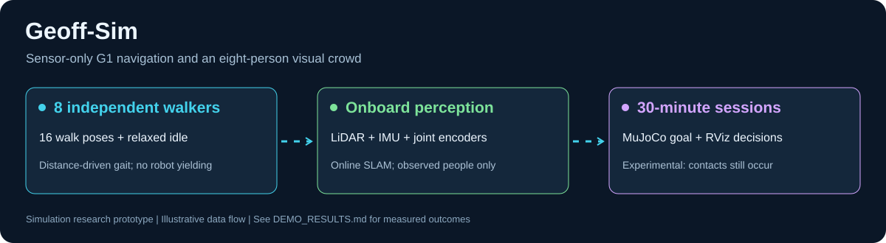
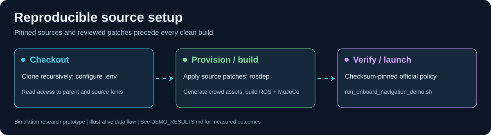
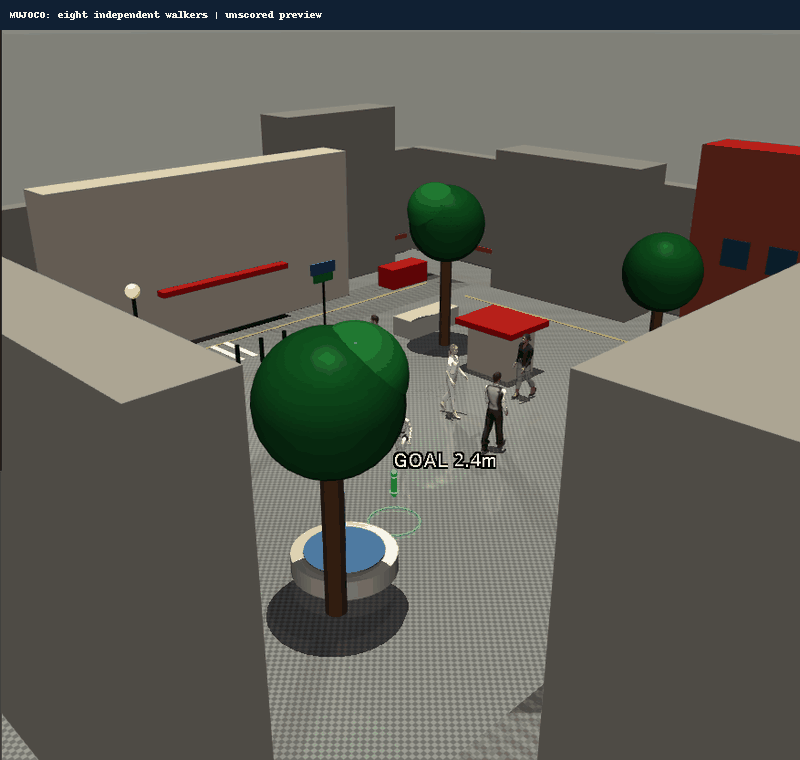
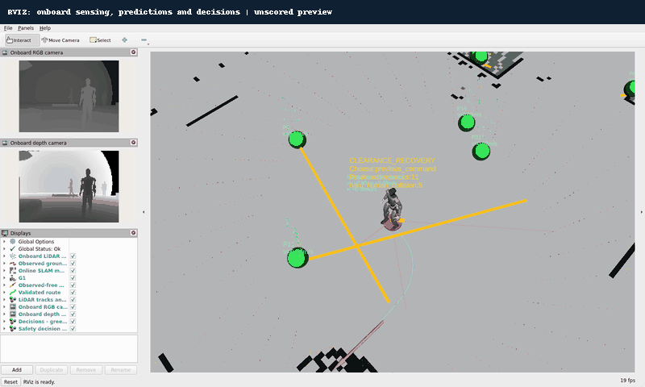
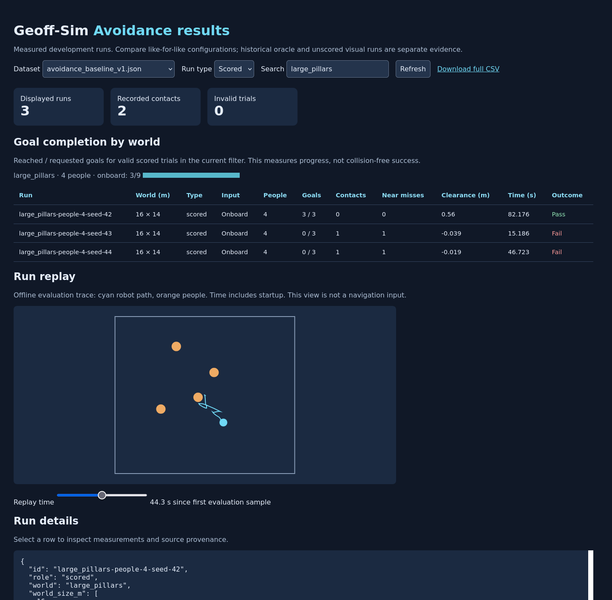
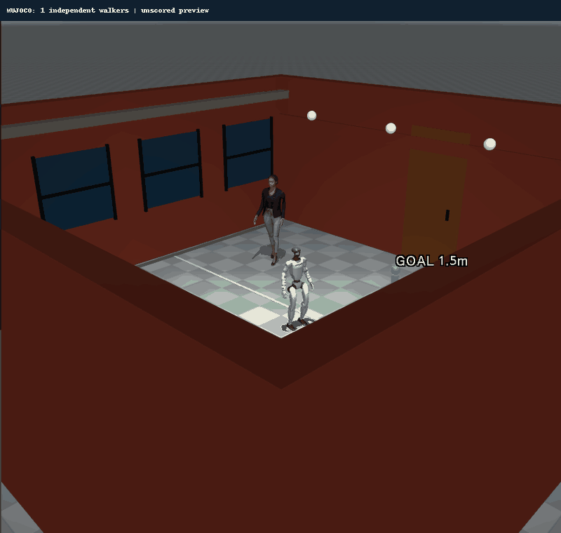
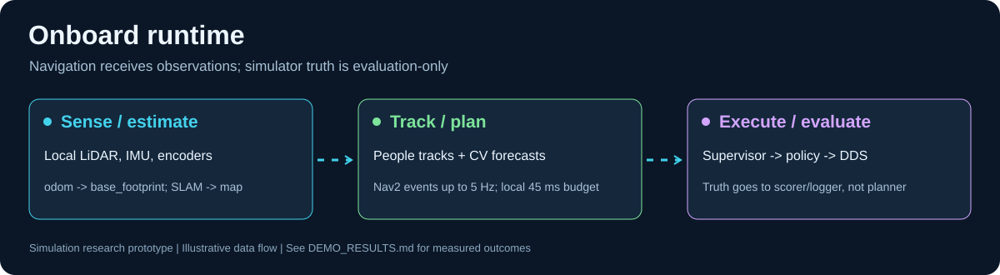
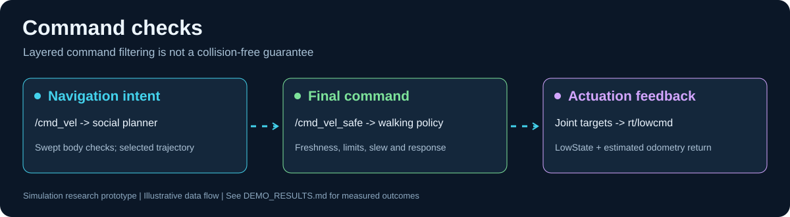
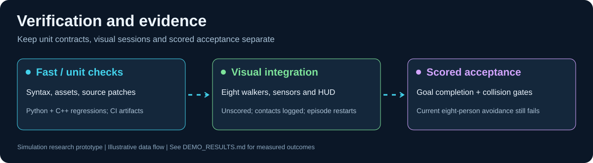

<div align="center">
  
  <p><strong>Unitree G1 · MuJoCo · ROS 2 Humble · Onboard social navigation</strong></p>
  <a href="https://github.com/DavidBatty95/Geoff-Sim/actions/workflows/verification.yml">Verification workflow</a>
</div>

Geoff-Sim is a simulation research platform for locomotion, online mapping,
human-aware navigation and reproducible avoidance experiments.

**Current status:** the onboard pipeline and visual demonstrations run, but
collision-free navigation is not yet reliable. Published datasets include
collisions, incomplete goals and invalid attempts. Historical oracle results
and unscored visual sessions are labelled separately.

## Quick start

Supported host: x86-64 Ubuntu/Debian Linux, Docker Compose v2, `/dev/dri`, and an
X11/XWayland display. ROS Humble and MuJoCo run in the container. NVIDIA support
is optional for training. Installation needs internet access and host privileges.

```bash
git clone --recurse-submodules https://github.com/DavidBatty95/Geoff-Sim.git
cd Geoff-Sim
./install.sh
./scripts/run_onboard_navigation_demo.sh
```

The convenient daily entry point is `./geoff`:

```bash
./geoff worlds
./geoff demo plaza
./geoff demo cafe --people 4 --duration 300 --fast-start
./geoff demo clinic --people 4 --duration 300 --fast-start
./geoff results
```

The installer initializes pinned sources, applies the reviewed [source patches](patches/README.md),
builds dependencies and generates pedestrian animation/world assets. The official
Unitree policy is downloaded and checksum-verified. Fork access may require your
GitHub credentials. After a first Docker installation, log out/in to activate
Docker group membership. See `./install.sh --help` for managed-host options.



## Run the visual demo

```bash
./scripts/run_onboard_navigation_demo.sh --duration 1800 --people 8 --seed 44
# Reuse a completed build for a shorter session:
./scripts/run_onboard_navigation_demo.sh --fast-start --duration 120 --people 4
```

MuJoCo shows relaxed-arm walking actors and a viewer-only goal ring. RViz shows
online SLAM, measured LiDAR, tracks, predictions, route candidates and the final
command. Visual goals hand off within 0.5 m. Sessions log contacts and may restart
after falls/data loss; they are **unscored**. Only run one simulator at a time.

| Recorded eight-person crowd | Recorded RViz decisions |
| --- | --- |
|  |  |

These previews are short recordings, not evidence of collision-free endurance.
The SVG illustrations are schematics. [Visual runbook](docs/ONBOARD_VISUAL_DEMO.md).

## Results GUI and avoidance dataset

The local browser GUI needs only Python 3; it does not need ROS or Docker to
inspect published results.

```bash
python3 scripts/avoidance_results_gui.py
# Open http://127.0.0.1:8765

# Inspect the separately labelled earlier demo evidence:
python3 scripts/avoidance_results_gui.py --dataset docs/results/demo_results.json --port 8766
```

Filter/search runs, compare per-world goal completion, inspect contacts, near
misses, clearance, duration and source hashes, and download CSV. Invalid attempts
remain visible. See [worlds and dataset methodology](docs/AVOIDANCE_EXPERIMENTS.md).



| World | Interior dimensions | Challenge |
| --- | --- | --- |
| `small_open` / `courtyard` | 8 × 8 m | Residential courtyard, doors, windows and wall lights |
| `small_clutter` / `cafe` | 8 × 8 m | Café courtyard, tables and planted tree |
| `medium_open` / `station` | 12 × 10 m | Station entrance, circulation markings and strip lighting |
| `medium_doorway` / `clinic` | 12 × 10 m | Clinic partitions, glazing and a 2 m doorway |
| `large_pillars` / `concourse` | 16 × 14 m | Station concourse, columns and platform signage |
| `large_office` / `office` | 16 × 14 m | Office lobby, partitions and wooden seating |



The world IDs remain stable for dataset comparison. Representative-v2 scenes
add original procedural surfaces, façades, furnishings and signage; simple-v1
baseline results remain separately labelled. These are stylized, human-scale
simulation environments rather than surveyed digital twins.

```bash
# Build once before collecting new runs:
docker compose run --rm unitree-g1-sim /workspace/scripts/build_unitree_mujoco.sh
# 18 serial trials: six worlds × three seeds, four people, three goals each:
python3 scripts/run_avoidance_matrix.py
# Export published measurements:
python3 scripts/avoidance_results_gui.py --export docs/results/avoidance_dataset.csv
```

The matrix reuses the existing ROS verification build, uses onboard-only
navigation and retains failed trials. It writes raw artifacts under the ROS
workspace's ignored results directory and publishes a portable JSON dataset.

## Scored and diagnostic runs

```bash
./scripts/run_demo_suite.sh --case onboard-waypoints --goals 3 --people 8 --seed 44 --headless --fast-start
./scripts/run_demo_suite.sh --case fixed-forward --headless --fast-start
./scripts/run_demo_suite.sh --suite quick --headless
```

`--headless` suppresses RViz; the standalone MuJoCo viewer may still need X11.
The mock benchmark verifies mechanics and is not locomotion/perception evidence.
The current strict mock acceptance gate can fail; do not relax it to conceal a
regression. [Demo suite](docs/DEMO_SUITE.md) · [Recorded results](docs/DEMO_RESULTS.md).

## Architecture



The onboard configuration uses simulated LiDAR, IMU and encoders for scan
odometry and online SLAM. Navigation goals come from observed free space.
LiDAR tracking and constant-velocity predictions feed event-driven replanning,
social trajectory selection and the final collision supervisor. The ONNX policy
converts safe commands into 29-joint targets over Unitree DDS.

Simulator truth is isolated to scoring/diagnostics. Actors plan around static
geometry and other actors independently of the robot. In generated worlds,
world geometry constrains actor motion; it is not supplied as a navigation map.




Forward/lateral command limits remain 0.65/0.45 m/s with 1.20 m/s² software
acceleration in the onboard demo. These are simulation settings, not validated
hardware limits. See [architecture](docs/ARCHITECTURE.md) and [source boundaries](docs/ONBOARD_SOCIAL_NAVIGATION.md).

Route following prefers turning toward the route before walking forward. The
onboard profile uses bounded pivot commands; short final-goal adjustments
and avoidance escapes may still use lateral movement. See [script entry points](scripts/README.md).
The official-policy demos use the same joint-action settings as the response
tests; forward/lateral command slew and low-level command validation remain active.

## Development and handoff



- [Documentation index](docs/INDEX.md)
- [Development and checks](docs/DEVELOPMENT.md)
- [Team handoff and remaining work](docs/HANDOFF.md)
- [Training and calibration tools](docs/TRAINING_AND_CALIBRATION.md)
- [Contributing](CONTRIBUTING.md) · [Security scope](SECURITY.md) · [Existing licenses](LICENSES.md)
- [Archived research drafts](archive/README.md)

Existing package/upstream licenses are preserved. A root-license decision and
third-party asset redistribution provenance remain owner decisions. Repository
branch protections, fork access and private vulnerability reporting require the
GitHub owner's configuration.
