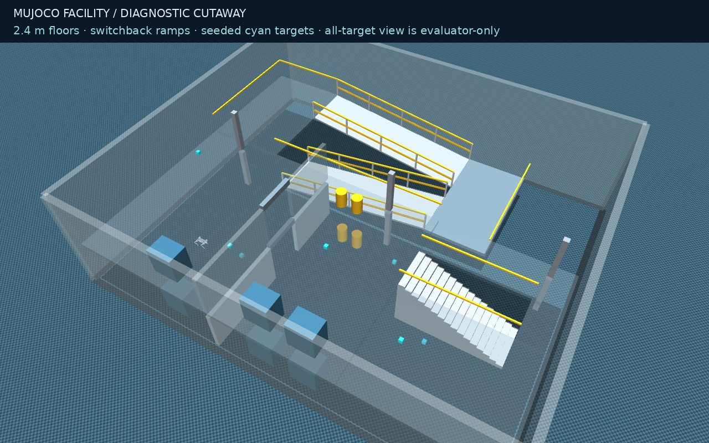
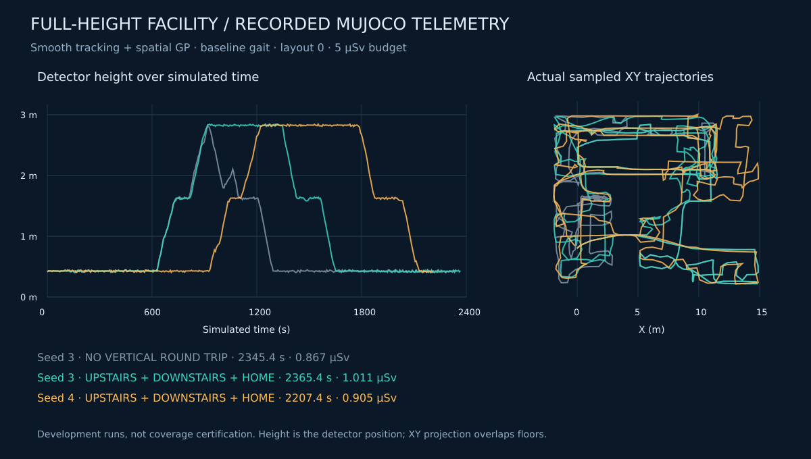
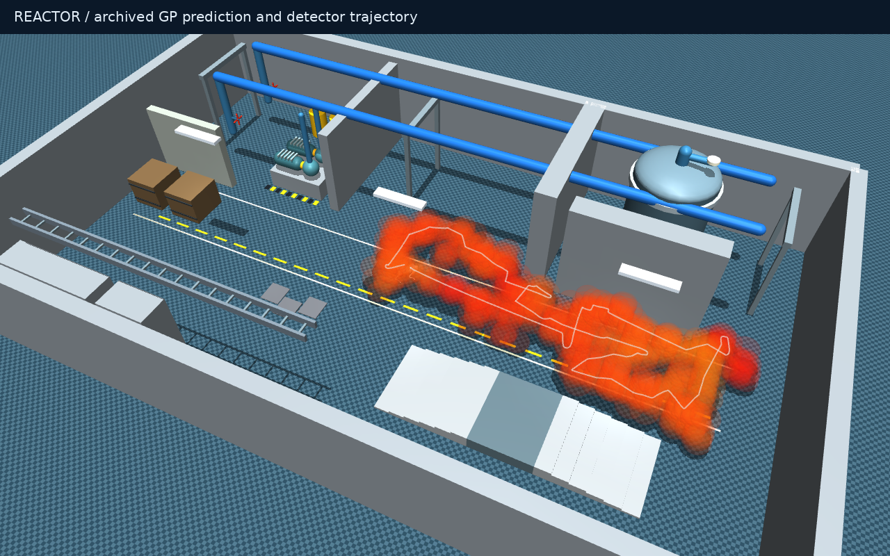

# Dougie-Sim


**Unitree Go2 · MuJoCo · ROS 2 Humble · Onboard sensor fusion · Dose-aware radiation mapping**

[](https://github.com/DavidBatty95/Dougie-Sim/actions/workflows/verification.yml)

[Quick start](#quick-start) · [Demo gallery](#recorded-demo-gallery) · [Run a mission](#run-a-radiation-mission) · [Results](#measured-results) · [Research](#research-and-design) · [Documentation](docs/DOUGIE_INDEX.md)

**Map an unknown facility while managing radiation exposure and retaining an
estimated return budget.** Dougie-Sim combines physical quadruped walking,
noisy body-frame LiDAR, IMU/leg/LiDAR pose estimation, a counting detector,
observed-geometry Gaussian processes and dose-aware exploration in a reactor-themed
environment. The default radiation mission plans from simulated onboard measurements.

Dougie is the quadruped sibling of [Geoff-Sim](https://github.com/DavidBatty95/Geoff-Sim).
It has an independent twelve-joint Go2 runtime and a pinned pretrained walking
policy. Geoff's source history and humanoid research remain available in the
[historical README](README-GEOFF.md).

**Robust-mission update — 21 October 2026: 243 tests pass.** Added quality-gated
keyframe localization, confirmed loop/anchor checks, frame-consistent terrain and
count-window replay, exposure-bounded recovery, and tracking-error clearance.
Information-per-cost scoring and whole-task lookahead are available for comparison;
**legacy utility remains the default because matched dose results were mixed**.
Both utility modes still use onboard fusion and the new recovery system.
[Staged implementation, tests and retained regressions](docs/DOUGIE_ROBUST_MISSIONS.md).

**Onboard measurement checkpoint — 19 October 2026: 212 tests passed.** Radiation missions
now default to **fused localization, observed-geometry GP kernels and moving-window
Poisson likelihoods**. Two short reactor trials returned cleanly with zero non-foot
contacts, using **0.1262 / 0.1227 µSv** against 2 µSv budgets. Position RMSE was
**7.4 / 5.9 cm**. These are development results; matched-coverage dose reduction,
long-duration drift and sensor-only multi-floor qualification remain open.
[Methods and evidence](docs/DOUGIE_ONBOARD_MISSION.md) · [Current plan](docs/DOUGIE_ONBOARD_PLAN.md)

**Earlier navigation update — 19 October 2026:** **201 tests passed**. Added cycle-scoped
route reuse, incremental support-footprint checks, consistent motion forecasts,
adaptive tracking and connected-region scheduling. Two mezzanine round trips and
a full-height seed-4 round trip passed with zero non-foot contacts using ideal pose. The full-height
run reached upstairs at **679.6 s** and returned at **2,295.4 s**, using **0.838 µSv**.
[Staged changes, measured tradeoffs and retained failures](docs/DOUGIE_NAVIGATION_EFFICIENCY.md).

**Planning update — 15 October 2026:** **190 tests pass**. Added persistent
frontier tasks, distant-frontier repositioning, explicit return-route rate checks,
turn/wait exposure forecasts, an inspection objective, free-space compaction and
seed-matrix evaluation. [Results and retained regressions](docs/DOUGIE_PLANNING_PRIORITIES.md).
At that checkpoint the planning revision still needed a fresh full-height trial;
the 19 October navigation update above now includes one. The full-height results
in the historical sections below belong to the earlier planner cohort.

**Earlier facility checkpoint:** Two smooth-tracking /
spatial-GP facility missions reached the **2.4 m upper floor**, descended and
returned home with **zero recorded non-foot impacts**, within a 5 µSv budget.
Optional seeded discovery targets are detected through range/FOV/occlusion checks
and displayed in RViz after discovery. [Results, retained failures and scope](docs/DOUGIE_FULLHEIGHT_RESULTS.md).

**Initial checkpoint — 7 October 2026:** the initial validation records 25 passing
tests and three radiation missions that returned within a 0.2 µSv budget in one
reactor layout. Physical simulation trials also crossed 6 cm stair risers and
2–4 cm floor plates. This is an initial integration and research baseline;
sensor-only autonomy, general dose safety and multi-floor coverage remain open.
[Read the measured scope](docs/DOUGIE_VALIDATION.md).

**Terrain update — [680 scored qualification trials](docs/DOUGIE_TERRAIN_QUALIFICATION.md):**
ordinary industrial stairs are **not qualified**. The tested 2 cm random-tile
distribution and 10° ramp courses passed 60/60 holdout repeats each. Earlier
6 cm stair completions included calf impacts or failed to repeat reliably;
they are demonstrations of traversal, not a validated operating envelope.

## Explore Dougie-Sim

| Capability | What runs today | Entry point |
|---|---|---|
| **Quadruped locomotion** | Free-floating Go2, twelve torque-controlled joints, 200 Hz physics / 50 Hz policy | `./dougie demo` |
| **Onboard localization** | Noisy IMU, encoders, foot forces and 5 Hz LiDAR; stance filter + local registration | `--localization fused` (default) |
| **Radiation mapping** | 2 Hz counts, eight-bin motion windows and observed-surface feature kernel | `--gp-mode geometry --detector-likelihood window` (defaults) |
| **Dose-aware exploration** | Observed multi-height support, route exposure, return reserve and deadline checks | `./dougie radiation` |
| **Planar comparison** | Horizontal scans, SLAM Toolbox, Nav2 and frontier goals | `./dougie explore` |
| **Terrain qualification** | Seeded courses, contact-aware scoring and independent repeatability trials | `./dougie terrain-qualify` |
| **Discovery targets** | Ideal semantic-sensor comparator; excluded from onboard missions | `--localization ground-truth --landmark-count 8 --landmark-seed 7` |
| **Reproducible evidence** | Seeded detector noise, source hashes, retained traces and independent exposure scoring | [Validation](docs/DOUGIE_VALIDATION.md) |

## Recorded demo gallery

### Onboard measurement checkpoint — actual recording and telemetry

| Onboard-only reactor mission | Sensor fusion and detector motion windows |
|---|---|
|  |  |

**Left:** a torque-driven MuJoCo recording from the 19 October onboard checkpoint, with the
radiation cloud hidden in the recording so the robot and routes remain visible.
The geometry-aware GP still runs. **Right:** telemetry from the same mission;
teal is the estimated pose, white the independent evaluator, and amber the moving
detector window. It is a log replay, not camera footage. Both animations are accelerated.
The new robust-navigation stages have separate measured results linked above;
these GIFs retain their original runtime identities.

Detector seed 3 / sensor seed 0: clean physical return at **47.050 s**, **5.693 m**
travelled, **0.126188 µSv** actual exposure, **0.3437 m** true home error (within
the 0.4 m gate), and zero non-foot contacts. Hidden pose and field truth are used
for sensor generation, diagnostic rendering and scoring—not mission decisions.
[Static mission](docs/media/dougie/onboard-mission.png) · [Static telemetry](docs/media/dougie/onboard-fusion.png) ·
[Provenance and regeneration](docs/DOUGIE_MEDIA.md#onboard-mission-refresh--19-october-2026) ·
[Portable evidence](docs/results/dougie_onboard_20261019.json)

### Historical multi-floor and initial integration gallery

The following media and full-height results use earlier ideal-pose configurations;
they do not qualify the new fused-localization mission.



The facility is simulated in **MuJoCo**; **RViz displays the same robot and mission
state over ROS**. This still is an actual model render with diagnostic transparency
and all targets shown. Live RViz publishes only discovered target markers.
[Graphics provenance](docs/DOUGIE_MEDIA.md).



Recorded telemetry, not a screen recording. Two development seeds on one layout
passed the vertical round trip; complete building/landmark coverage and real-time
performance under load remain open. [Full result table](docs/DOUGIE_FULLHEIGHT_RESULTS.md).

| Go2 walking in MuJoCo | Radiation mission data replay |
|---|---|
|  |  |

**Left:** the original six-second physics recording, commanded at 0.3 m/s with a following
camera; the command is not a measured speed. **Right:** an accelerated XY replay
of the recorded seed-3 mission's detector samples and planner states. The line is
the sampled path, not a GP field or a screen recording. The two panels show
separate runs. [Media provenance, portable replay data and regeneration](docs/DOUGIE_MEDIA.md).


The reactor now has detailed pump assemblies, vessel fittings, valve handles,
pipe racks, control panels, a cable tray and a shielded storage alcove.
Two updated-room missions returned cleanly after **265.6 / 261.5 s**, travelling
**33.80 / 32.69 m** with zero non-foot impacts and **0.796 / 0.840 µSv** exposure
against a 2 µSv budget. The final cloud-rendering benchmark measured **30.2 FPS**.
[Updated reactor and prediction-display results](docs/DOUGIE_REACTOR_UPDATE.md).



The prediction image replays archived GP/count evidence on a stable, locally
interpolated translucent cloud grid. It is not a true-field map or live recording.

The reactor image is a model render. The animated title and architecture below
are schematics. Visual previews illustrate the system; scored claims come from
the [15 October reactor evidence](docs/results/dougie_reactor_detail_20261015.json)
and the separate [initial validation cohort](docs/results/dougie_initial_20261007.json).

## Quick start

### Requirements

- Linux with Docker Engine and **Docker Compose v2 or newer**; the container
  provides ROS 2 Humble, MuJoCo and CPU PyTorch.
- Internet access for the first build and checksum-verified public assets.
- X11/XWayland and a valid `DISPLAY` for interactive MuJoCo/RViz windows.
  Headless simulation needs no display server or GPU.
- Permission to run Docker and write the working checkout. Host ROS installation
  and recursive private submodule checkout are not needed for the Go2 profile.

```bash
git clone https://github.com/DavidBatty95/Dougie-Sim.git
cd Dougie-Sim
./dougie setup
./dougie radiation --dose-budget 2 --duration 90 --seed 3
```

Setup downloads the public Go2 model/meshes and `rl_sar` Go2 `robot_lab` policy
from immutable commits, verifies SHA-256 checksums, caches them under `.dougie/`,
then builds `dougie-sim:humble`. See the [asset manifest](config/dougie_assets.json)
and [attribution](docs/DOUGIE_SIM.md#attribution).

For a display-free first mission, replace the last command with:

```bash
./dougie radiation --headless --fast --dose-budget 2 --duration 90 --seed 3 \
  --sensor-seed 0 --fixed-plan-delay .5 --require-clean
```

`--duration` is a simulated-time limit. `--fast` requires `--headless`, removes
wall-clock pacing and disables ROS publication. It does not guarantee a particular
speedup. Omit `--fast` for paced runs with ROS topics.

## Run a radiation mission

The default field now contains **point-source hotspots and localized leaks**.
Use `--show-sources` for red hotspot/amber leak markers, or omit it to display
only the learned GP map. [Source locations, strengths and configuration](docs/DOUGIE_SOURCES.md).

Radiation is displayed as a **continuous, low-opacity haze**, yellow at lower
estimated excess and red at higher excess. It fades smoothly near Go2 to keep the
robot visible; that display fade does **not** indicate a low-radiation zone.
Measured count evidence remains marked by small cubes.
[Before/after views and rendering details](docs/DOUGIE_RADIATION_DISPLAY.md).
`--show-sources` adds prominent source cores, elevated beacons,
rings and labels; these are diagnostic true-source annotations. The cloud changes
appearance only, not the field used for route planning.

```bash
# Interactive reactor mission: onboard fusion, geometry kernel, window likelihood:
./dougie radiation --source-profile hotspots-and-leaks --show-sources --dose-budget 2 --rate-limit 100 --duration 600

# Recorded-development configuration, no display or DDS:
./dougie radiation --headless --fast --dose-budget 2 --duration 90 --seed 3 \
  --sensor-seed 0 --fixed-plan-delay .5 --require-clean

# Comparison likelihood and smaller GP dictionary:
./dougie radiation --headless --fast --gp-mode global --gp-likelihood gaussian \
  --gp-capacity 64 --duration 180

# Controlled inference ablation, retaining onboard localization:
./dougie radiation --headless --fast --gp-mode global --detector-likelihood point \
  --dose-budget 2 --duration 90 --seed 3 --sensor-seed 0 --fixed-plan-delay .5

# Longer-mission experiment: five times the dose allowance, 600 s time cap:
./dougie radiation --headless --fast --dose-budget 10 --duration 600 \
  --seed 3 --sensor-seed 0 --fixed-plan-delay .5 --require-clean
```

[Paired 2/10 µSv longer-mission protocol and results](docs/DOUGIE_LONG_MISSIONS.md)
compare physical visitation, dose, return success and localization error.

| Option | Default | Meaning |
|---|---:|---|
| `--dose-budget` | `2` | Cumulative exposure budget in **µSv** |
| `--rate-limit` | `100` | Measured rate threshold in **µSv/h** |
| `--duration` | `600` | Maximum simulated mission time in seconds |
| `--seed` | `1` | Detector-noise seed; does not randomize facility geometry |
| `--localization` | `fused` | IMU/leg/LiDAR estimation; `ground-truth` is an explicit historical comparator |
| `--sensor-seed` | `0` | Separate seed for IMU biases/noise, encoders, foot forces and LiDAR noise/dropout |
| `--navigation-profile` | `robust` | Quality-gated submaps, consistent map revisions and bounded recovery; `legacy` retains the earlier navigation comparator |
| `--utility-mode` | `legacy` | Prior candidate utility; `information` enables experimental information/cost scoring and observed-circuit lookahead |
| `--gp-capacity` | `128` | Maximum inducing dictionary size |
| `--gp-mode` | `geometry` | Observed-surface feature kernel, `global` Matérn comparator, or `spatial` experts |
| `--detector-likelihood` | `window` | One integrated Poisson count over motion bins; `point` uses the window's mean position |
| `--path-mode` | `smooth` | Support/risk-checked smooth execution or historical grid following |
| `--require-round-trip` | Off | Evaluator requires clean upstairs/downstairs/home witnesses |
| `--landmark-count`, `--landmark-seed` | `0`, `0` | Ideal semantic targets; require explicit `--localization ground-truth` |
| `--mission-objective` | `survey` | `inspect` prioritizes observed semantic targets in the ideal-sensor comparator; `circuit` freezes four initially observed support goals |
| `--require-circuit` | Off | Require all four independent physical goal witnesses and a clean home return |
| `--region-scheduling` | `hierarchical` | Connected-region scheduling on layered terrain; `local` retains the local-preference comparator |
| `--gp-likelihood` | `poisson` | Poisson/Laplace inference or `gaussian` log-Gaussian approximation |
| `--source-profile` | `hotspots-and-leaks` | Combined emitters, `hotspots`, `leaks`, or the original `baseline` |
| `--source-config` | Built-in JSON | Alternative source file inside the checkout |
| `--show-sources` | Off | Diagnostic true-source markers; never supplied to autonomy |
| `--headless` | Off | Suppress the MuJoCo viewer |
| `--fast` | Off | Headless unpaced physics without ROS |
| `--record-view` | `field` | With `--record-demo`, `routes` records a closer view without the field cloud |

### What to expect

The interactive demo now opens **RViz in a separate process**. MuJoCo runs
physics without a viewer. RViz shows the diagnostic world geometry, articulated
Go2 visual meshes, learned GP volume, planned/travelled paths and mission
state. See [rendering performance and measurements](docs/DOUGIE_PERFORMANCE.md).

Interactive launches now select GPU graphics automatically where available.
Use `./dougie graphics-check --require-hardware` to confirm the actual renderer;
the NVIDIA facility benchmark measured approximately **30 FPS** with the full Go2
model. Explicit overrides include `--graphics nvidia` and `--graphics dri`.

The live dashboard shows measured dose against budget, rate against threshold,
estimated return reserve and the planner's decision. **Green** marks the current
plan and target, **blue** the travelled path, and **amber** the estimated return
route. A legend explains the GP mean/uncertainty colours; the final view stays
open for inspection.

Routes now use support-checked smoothing and slew-limited steering. The radiation
overlay highlights **above-background count evidence and nearby GP estimates**,
instead of painting unmeasured space from the prior. Use `--show-sources` for
labelled diagnostic source beacons, `--gp-mode spatial` for optional local GP
experts, and `--path-mode grid` for the original follower.
[Methods, motion benchmarks and incline training results](docs/DOUGIE_SMOOTH_MAPPING.md).

1. Go2 settles into stance, then the mission uses observed support surfaces to
   select routes. It does not receive hidden source positions or a facility map.
2. IMU, joint/foot measurements and body-frame LiDAR update an estimated pose.
   A counting detector reports every 0.5 s; estimated detector positions and dwell
   durations form one integrated likelihood per window.
3. Candidate routes trade coverage and uncertainty against travel and estimated
   dose. Admission includes a known-route return estimate and a budget reserve.
4. High measured rate, budget use or the return-time allowance can trigger retreat.
   Stale sensing/planning gates motion; a return can still fail.
5. The run writes its measurements, predictions and independently scored outcome
   into `results/dougie/radiation_*/`. Ctrl+C stops the session.

In the viewer, colored spheres show the **learned GP mean**, not the hidden true
field. A predicted map can look complete even where uncertainty is high; inspect
the sampled height range and uncertainty before interpreting it.

The units are synthetic dose-equivalent proxies, not a calibration of Go2
electronics damage. MuJoCo handles mechanics; a separate attenuation-only field
model supplies radiation observations. [Full methods and assumptions](docs/DOUGIE_RADIATION.md).

## Walking, exploration and ROS

### Experimental multi-level milestone

The new **full-height facility** has overlapping rooms separated by 2.4 m,
switchback service ramps, equipment, shielding and a genuine stair challenge.
A development mission reached the upper floor and returned without recorded
non-foot contacts. RViz now renders the verified articulated **Go2 meshes**.

The historical corrected smooth/spatial runs passed the round-trip gate for detector
seeds 3 and 4: home at **2,365.44 / 2,207.44 s**, actual exposure **1.01076 /
0.90453 µSv** out of 5 µSv. Seed 4 returned at mapping capacity; these outcomes
do not certify full coverage. [Latest methods and results](docs/DOUGIE_FULLHEIGHT_RESULTS.md).

```bash
# Historical ideal-pose comparator; fused full-height qualification is still open:
./dougie radiation --world facility --duration 2400 --dose-budget 5 --gp-mode spatial \
  --localization ground-truth --navigation-profile legacy --detector-likelihood point --seed 3

# Strict headless full-height evaluation:
./dougie radiation --world facility --headless --fast --duration 2400 --dose-budget 5 \
  --gp-mode spatial --localization ground-truth --detector-likelihood point \
  --navigation-profile legacy --seed 3 --fixed-plan-delay .5 --require-round-trip

# Optional visible-only discovery targets, with RViz:
./dougie radiation --world facility --duration 2400 --dose-budget 5 \
  --gp-mode spatial --localization ground-truth --detector-likelihood point \
  --navigation-profile legacy --landmark-count 8 --landmark-seed 7
```

[Facility, controller comparisons and retained failures](docs/DOUGIE_FACILITY.md).
This is an experimental ramp-access mission; ordinary stairs remain unqualified.
The smaller, faster vertical fixture is still available:

```bash
./dougie radiation --world mezzanine --duration 300 --dose-budget 2 --seed 3 \
  --localization ground-truth --navigation-profile legacy --gp-mode spatial --detector-likelihood point
```

The new observed-slope mapper supports a two-ramp raised gallery with explicit
radiation shielding. Two development seeds reached the gallery and returned
upright without recorded non-foot impacts. This is a low-mezzanine milestone;
ordinary stairs and complete unknown-building exploration remain unqualified.
[Full TXT plan](docs/DOUGIE_MULTIFLOOR_PLAN.txt) ·
[Implementation, GPU training and measured results](docs/DOUGIE_MULTIFLOOR_PROGRESS.md).

### Ordinary walking and planar exploration

```bash
./dougie worlds
./dougie demo --world flat --vx 0.3 --duration 30
./dougie demo --world room
./dougie explore --world office --duration 300
./dougie explore --world office --people 1 --duration 300
```

`demo` and `explore` open RViz, with MuJoCo physics running without a viewer.
Both accept `--headless`.
The zero-command demo balances until it receives commands and can drift.
Exploration uses planar SLAM/Nav2; completed office coverage is not yet established.
Moving people are simplified kinematic capsules, not validated crowd behavior.

| Scene | How to select it | Purpose |
|---|---|---|
| `flat` | `demo --world flat` | Open-plane policy response |
| `room` | `demo --world room` | 12 × 12 m enclosure, scans and manual commands |
| `office` | `explore --world office` | Partitions, furniture and planar frontiers |
| `reactor` | `radiation` | Shielding, vessel, drums, floor plates and inspection deck |
| `mezzanine` | `radiation --world mezzanine` | Low raised-gallery development fixture |
| `facility` | `radiation --world facility` | Full-height two-storey rooms, service ramps and an unqualified staircase |
| `stairs` | `terrain-test` | Legacy small-riser completion demonstration; use `terrain-qualify` for qualification |

`worlds` lists all scenes; `demo` and `explore` accept only `flat`, `room`, or
`office`. Reactor and stair runs have their dedicated entry points.

### Send velocity commands

Start `./dougie demo --world room`. In a second terminal:

```bash
./dougie shell
# Inside the ROS-enabled container shell:
ros2 topic pub --rate 10 /cmd_vel geometry_msgs/msg/Twist '{linear: {x: 0.2}, angular: {z: 0.0}}'
```

Stopping publication triggers the **0.5-second command watchdog**. Use one command
source at a time. Radiation mode owns motion and ignores external `/cmd_vel`;
ordinary exploration owns its navigation commands. The ordinary demo's basic
scan-based forward stop is not Geoff's human-aware planner.

### Inspect live topics

During a paced ROS-enabled session, enter `./dougie shell` and run:

```bash
ros2 topic list
ros2 topic hz /scan
ros2 topic echo --once /odom
# During a radiation session without --fast:
ros2 topic echo --once /radiation/status
ros2 topic echo --once /radiation/measurement
```

| Interface | Content |
|---|---|
| `/clock`, `/tf` | Simulation time and transforms |
| `/odom`, `/imu`, `/joint_states` | Simulator pose, IMU and twelve-joint state |
| `/scan` | Ideal horizontal raycast scan |
| `/cmd_vel` | Ordinary-demo velocity input / ordinary-exploration commands |
| `/radiation/measurement`, `/radiation/status` | JSON in `std_msgs/String` |
| `/radiation/gp_map` | `sensor_msgs/PointCloud2`: XYZ, mean, upper rate and log-rate uncertainty |
| `/radiation/landmarks` | Retained discovered/inspected target markers; unseen targets are not published |

DDS defaults to loopback-only domain **43**. `./dougie shell` shares that
configuration; host tools need matching DDS settings.

## Architecture


- **Physics and policy:** the pinned policy maps a 45-value observation to twelve
  actions; PD control applies joint torques. The free base is integrated by
  MuJoCo with no execution-time teleportation or stabilizing tether.
- **Observed terrain:** 3-D ray returns and estimated surface normals create a
  multi-height support graph. Unknown support is not traversable. Conservative
  reactor mapping uses a 2 cm step limit; layered facility mapping checks local
  planes, slope connectivity and support footprint. Industrial stairs are unqualified.
- **Localization:** body-frame IMU, encoders, foot forces and noisy LiDAR feed a
  stance-leg filter and quality-gated keyframe registration. Confirmed loop
  corrections reproject retained terrain and count windows together. Old-revision
  routes are withheld. The walking policy receives estimated gravity and measured joints.
- **Radiation inference:** a positive log-rate field uses a Matérn-3/2 ARD kernel
  multiplied by a positive-definite observed-surface feature kernel. Joint-window
  Laplace updates assimilate each integrated count once. New kernel geometry
  triggers bounded history replay; unknown material attenuation is not supplied.
- **Planning:** route exposure uses upper GP rates, measured cumulative counts,
  return routes, a 15% budget reserve and a dwell allowance. This is a heuristic,
  not a proof of optimal coverage or probabilistic dose safety.
- **Concurrency:** a background worker processes detached observations while
  physics continues; the main loop checks sensor and plan freshness.
- **Recovery:** fresh-observation holds and checked retreats are bounded by time
  and exposure. An unrecoverable stop remains a failed mission; dose accounting
  continues to the original deadline rather than claiming an artificial saving.

**The default radiation planner uses estimated pose and simulated onboard sensors.**
The explicit ground-truth comparator, ordinary planar profile, visual scene and
independent evaluator retain diagnostic simulator state. Sensor noise and local
odometry are research models, not calibrated Go2 L1 hardware or fully qualified pose-graph SLAM.
[Architecture and source boundaries](docs/DOUGIE_SIM.md).

## Outputs and reproducibility

Ordinary sessions and radiation missions write under `results/dougie/`.
For radiation, keep the whole run directory:

| Artifact | What to inspect |
|---|---|
| `run_config.json` | CLI settings, source hashes and asset-manifest identity |
| `source_scenario.json` | Selected point-source profile and resolved simulator configuration |
| `measurements.jsonl` | Counts, estimated XYZ motion bins, dwell durations, measured rate and dose |
| `localization_evaluation.jsonl` | Pose estimate versus evaluator-only physics pose; never a planner input |
| `map_corrections.jsonl` | Onboard-derived, versioned corrections; use with measurement `map_revision` when reconstructing a common map frame |
| `trace.jsonl` | Mission states, observed coverage and planning timings |
| `radiation_summary.json` | Outcome, estimated/actual exposure, return and sampled heights |
| `landmark_observations.json` | Visible semantic target observations and latched inspection state |
| `landmark_evaluation.json` | Evaluator-only target catalogue and per-floor discovery/inspection counts |
| `radiation_map_3d.npz` | XYZ queries, mean/upper rates and log-rate uncertainty |
| `gp_posterior.npz` | Inducing coordinates, posterior and kernel parameters |
| `observed_geometry.npz` | Range hits and sampled observed-free voxels |
| `evaluator_field.json` | Post-run hidden field for evaluation, never a planner input |

Compare runs using actual dose, return outcome, geometric coverage and field error
together. A larger coverage proxy alone can conceal a budget exceedance or failed
return. Seeds vary counting noise in the same layout; record configuration/source
hashes and retain failed runs. [Report reproduction](docs/DOUGIE_VALIDATION.md#reproduce-the-portable-report).

## Measured results

### Robust-navigation validation — 21 October

The revised defaults returned cleanly on detector/sensor seed 4/1 at both budgets:
**389.870 s / 1.267477 µSv** with 2 µSv allowed, and **427.965 s / 0.775721 µSv**
with 10 µSv allowed. Both recorded zero non-foot contacts. Position-error p95 was
**1.7 / 12.4 cm**. The larger-budget run exercised loop correction and coherent
map replay. Different trajectories prevent a matched-coverage dose claim.

The new information/whole-task scorer completed the matched observed-goal tests,
but dose changes across three seed pairs were mixed: **+3.3%, +5.2%, −6.1%**.
It remains selectable; legacy utility stays the default. A later tracking-clearance
recheck passed the previously contacting case without weakening its gate.
[Full staged evidence and limits](docs/DOUGIE_ROBUST_MISSIONS.md).

### Earlier onboard measurement results — 19 October

**Longer-mission follow-up:** a paired **2 versus 10 µSv** experiment with a
**600 s cap** produced three clean returns out of four trials. One higher-budget
run improved physical visitation per dose by **24.6%**; the other failed to return
after a support/sensing wait. Higher allowance alone did not resolve longer-term
localization and mapping limits. [Full efficiency table and retained failure](docs/DOUGIE_LONG_MISSIONS.md).

Reactor scene, 90 s limit, 2 µSv budget, geometry GP, moving-window likelihood and
fixed 0.5 s simulated planning delay. Both trials used noisy onboard localization.

| Detector / sensor seed | Return (s) | Actual dose (µSv) | Distance (m) | Position RMSE | Outcome |
|---|---:|---:|---:|---:|---|
| 3 / 0 | 47.050 | 0.126188 | 5.693 | 7.4 cm | Clean physical return |
| 4 / 1 | 37.050 | 0.122702 | 4.221 | 5.9 cm | Clean physical return |

The seed-3 GIF run reproduced the scored trajectory. These short runs returned
when no further admissible work was selected; they do not establish complete
coverage or improved dose at matched work. Noisy support heights can inflate
surface-cell proxies, so these proxies are not directly comparable to ideal-pose
cohorts. Initial fusion/mapping failures are retained in the
[portable report](docs/results/dougie_onboard_20261019.json).

### Frozen initial integration cohort

The frozen initial Poisson cohort used a **0.2 µSv budget**, **100 µSv/h rate
threshold**, **128 inducing points** and **180 s maximum** in one reactor scene.
Select `--source-profile baseline` to reproduce that field; the new default
hotspot/leak scenario has different source positions and concentrations.

| Detector seed | Return time (s) | Actual dose (µSv) | Observed surface proxy (m²) | Outcome |
|---|---:|---:|---:|---|
| 1 | 123.20 | 0.08283 | 131.81 | Returned upright, within budget |
| 2 | 149.26 | 0.11124 | 124.94 | Returned upright, within budget |
| 3 | 135.23 | 0.10429 | 133.56 | Returned upright, within budget |

Home tolerance was 0.4 m. These three noise repeats are not a general reliability
study. Surface area is a discretized observed-geometry proxy, not full facility
coverage. Sensor heights were approximately **0.39–0.46 m**, so XYZ prediction
does not establish volumetric radiation reconstruction.

| Separate qualification | Recorded finding | Scope |
|---|---|---|
| Software/interfaces | 25 tests passed, including real-DDS radiation publication | Dated initial checkpoint |
| Small stairs | Six ascent + six descent contacts, 6 cm risers, 36 cm deck | Heading-guided course, not autonomous stair discovery |
| Uneven floor | Three 2–4 cm plates contacted, upright traversal | Dedicated course |
| Poisson GP, capacity 128 | 0.245 ms update p95; 9.48 ms / 1,000-query batch | Synthetic benchmark, host-dependent |
| GP accuracy, same benchmark | 0.439 log1p-rate RMSE; 36.54 µSv/h raw-rate RMSE | Substantial hotspot error remains |

The small-stair/plate rows above preserve the initial demonstrations. The
[later terrain assessment](docs/DOUGIE_TERRAIN_QUALIFICATION.md) supersedes any
interpretation of them as reliable or clean terrain qualification.

[Full validation and caveats](docs/DOUGIE_VALIDATION.md) · [Machine-readable evidence](docs/results/dougie_initial_20261007.json)

## Research and design

The central question is **how much useful geometry and radiation information a
walking robot can acquire before its estimated exposure and return costs consume
the mission budget**. Source seeking, map reconstruction and safe return are
different objectives; Dougie evaluates them through a combined mission baseline.

| Research foundation | Connection to Dougie | Implementation boundary |
|---|---|---|
| [West et al., Scientific Reports 2021](https://doi.org/10.1038/s41598-021-93474-4) | Irregular low-count radiation observations, positive log fields, Poisson likelihood and Matérn kernels | Real reactor surveys on Jackal; Dougie uses a synthetic field and bounded online approximation |
| [Stephens et al., Autonomous Robots 2024](https://doi.org/10.1007/s10514-024-10172-6) | GP-informed hazard exploration and return reasoning | SafeEstMDP is a future comparator; current routing is heuristic |
| [Chen, Liu and Khardon, POAM, RSS 2024](https://arxiv.org/abs/2406.03669) | Computationally bounded online mapping and nonstationary models | Dougie does not implement POAM's attentive kernel, inducing replacement or variational EM |
| [Sudha, Jose and Coates, ECMR 2025](https://arxiv.org/abs/2507.13053) | Streaming GP mapping while moving | Their static 2-D setting and growing inducing set differ from Dougie's capped XYZ model |

The [research reading guide](docs/DOUGIE_RESEARCH.md) connects the papers to source
files, explains rate versus cumulative dose, and defines proposed comparisons.
The [methods review](docs/DOUGIE_RADIATION.md#research-findings-and-design-choices)
records inspection depth and access limitations. This is a targeted research
synthesis, not a claim to reproduce or outperform the cited systems.

### Current implementation and next research milestones

Sensor fusion, observed-geometry kernels and moving-window likelihoods are now
implemented and tested. The [active onboard plan](docs/DOUGIE_ONBOARD_PLAN.md)
separates implementation from qualification and defines the next acceptance gates.

1. **Matched baselines:** radiation-blind frontiers, mean-only risk and upper-bound
   risk under matched sensing and compute; report dose, coverage and return failures.
2. **Field generalization:** held-out source/shield layouts, sharp-hotspot error,
   uncertainty calibration and alternative kernels.
3. **Motion-aware reserves:** measured travel-time distributions and larger-riser
   qualification before multi-storey missions.
4. **Onboard qualification:** long-duration drift, degenerate scenes, dropout,
   timestamp delays, and sensor-only multi-floor return; loop closure remains open.
5. **Volumetric evidence:** independent sampling at multiple detector heights.
6. **Radiation fidelity:** transport-generated reference fields and calibrated
   detector response.

These are proposed qualification gates, not completed research results. The inherited
[Geoff literature review](docs/literature_review/README.md) remains a humanoid
research reference; its results and manipulation capabilities do not transfer to Go2.

## Verification and development

```bash
./dougie test
./dougie terrain-test
./dougie terrain-qualify --suite matrix --workers 6
./dougie terrain-qualify --suite repeatability --workers 6
./dougie benchmark-gp
python3 scripts/check_dougie_docs.py
```

An ordinary ROS smoke run and artifact check:

```bash
./dougie demo --headless --duration 8
python3 scripts/check_dougie_run.py
```

Default CI builds the Go2 image and checks policy/model ordering, physical
standing/walking/turning, scans, watchdogs, frontier planning, detector statistics,
GP posteriors, dose-return behavior, terrain and ROS interfaces. The active profile
does not build inherited G1 ROS packages.

`terrain-qualify` records stability, contacts, penetration, joint limits,
landing/corridor witnesses, settling and repeated outcomes. Its default exit
status reports successful evidence collection; add `--require-qualified` to
fail the command when a robot trial fails qualification. `terrain-test` retains
the original completion-only demonstration.

### Troubleshooting

| Symptom | What to check |
|---|---|
| `docker compose` unavailable / Docker denied | Install Compose v2+, ensure the daemon is running and your user has Docker access |
| Missing model or policy | Run `./dougie setup`; inspect download/checksum errors and network access |
| `DISPLAY is unset` | Use `--headless`, or launch from a graphical session with its existing display environment |
| X11 authorization failure | Pass the session's existing `DISPLAY` and valid `XAUTHORITY`; if required, authorize the container user with `xhost +si:localuser:$(id -un)` |
| No radiation topics | Omit `--fast`; inspect from `./dougie shell` in the matching DDS domain |
| Robot stands still | Default demo velocity is zero; send `/cmd_vel` or set `--vx`; exploration can also wait for map/planner readiness |
| RViz runs at a few FPS | Restart through `./dougie`; run `./dougie graphics-check --require-hardware`. `llvmpipe` means CPU rendering. Try `--graphics nvidia` or `--graphics dri`; see the [graphics guide](docs/DOUGIE_PERFORMANCE.md#gpu-graphics-fix-and-measured-rviz-fps--13-october-2026) |
| `--world reactor` rejected | Use `./dougie radiation`; `demo`/`explore` accept only flat, room and office |
| Return or budget failure | Inspect summary and trace; an estimated reserve is not a guarantee against falls, blockage or model error |

Only run one interactive command-owning ROS session per domain. Ctrl+C stops the
session and its child processes. For display access details, use the existing
session credentials rather than disabling X server access control globally.

## Repository map

| Path | Responsibility |
|---|---|
| [`dougie`](dougie), [`scripts/dougie_cli.py`](scripts/dougie_cli.py) | Daily commands and container launch |
| [`dougie_sim/simulation.py`](dougie_sim/simulation.py) | Model construction, policy adapter, physics and ideal range sensors |
| [`dougie_sim/onboard_sensors.py`](dougie_sim/onboard_sensors.py), [`dougie_sim/odometry.py`](dougie_sim/odometry.py) | Body-frame noisy sensor boundary and IMU/leg/LiDAR pose estimation |
| [`dougie_sim/radiation.py`](dougie_sim/radiation.py), [`dougie_sim/gp.py`](dougie_sim/gp.py) | Field/detector model and bounded inference |
| [`dougie_sim/geometry_gp.py`](dougie_sim/geometry_gp.py) | Observed-surface feature kernel and bounded count-window replay |
| [`dougie_sim/terrain.py`](dougie_sim/terrain.py), [`dougie_sim/dose_planner.py`](dougie_sim/dose_planner.py) | Observed support and dose-aware decisions |
| [`dougie_sim/radiation_run.py`](dougie_sim/radiation_run.py) | Radiation mission lifecycle, viewer and artifacts |
| [`dougie_sim/ros_bridge.py`](dougie_sim/ros_bridge.py), [`dougie_sim/explore.py`](dougie_sim/explore.py) | ROS interfaces and planar comparison |
| [`config/`](config/), [`docker/Dockerfile.dougie`](docker/Dockerfile.dougie) | Verified assets, ROS settings and container dependencies |
| [`tests/dougie/`](tests/dougie/) | Go2-specific validation |
| [`docs/DOUGIE_INDEX.md`](docs/DOUGIE_INDEX.md) | Active guides, methods, evidence and media |
| [`README-GEOFF.md`](README-GEOFF.md), [`ros2_ws/`](ros2_ws/), [`vendor/`](vendor/) | Inherited Geoff source and research history |

## Attribution and contributing

Dougie preserves Geoff-Sim history at
`d1d54ff974e44546e260d3ccf6e3cb1f8f3a7568`. The Go2 model comes from
`unitreerobotics/unitree_mujoco` (BSD-3-Clause); the policy and observation contract
come from `fan-ziqi/rl_sar` (Apache-2.0). Assets and their upstream licenses are
downloaded together. Existing package notices remain in force.

[Attribution details](docs/DOUGIE_SIM.md#attribution) · [Licensing inventory](LICENSES.md) ·
[Contributing](CONTRIBUTING.md) · [Security scope](SECURITY.md)

For Go2 changes, start with the commands above and include configuration, source
identity and measured outcomes when reporting experiments. No blanket relicensing
of the inherited repository is implied.
