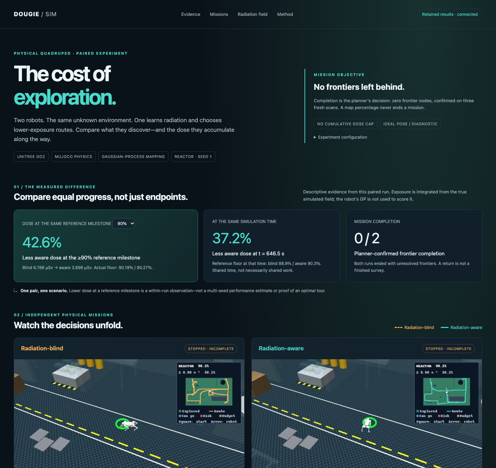
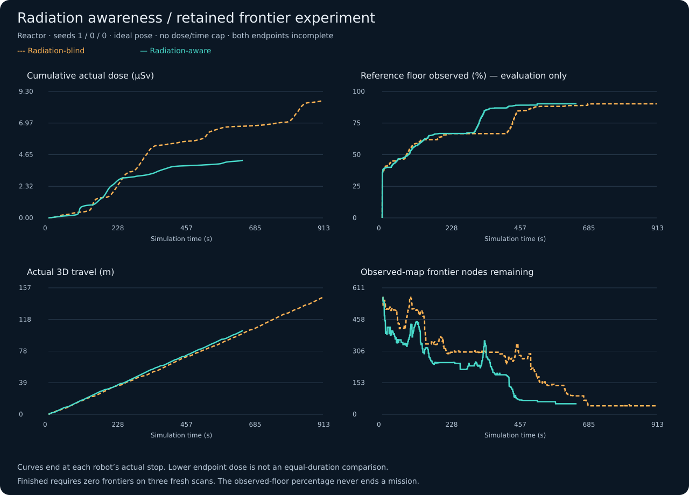
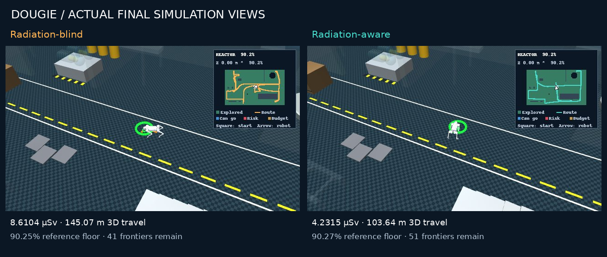
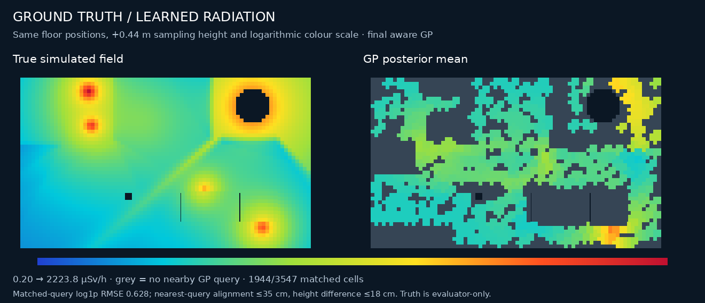

# Dougie-Sim

## Frontier-driven, dose-aware quadruped exploration of unknown radiation fields

**Unitree Go2 · MuJoCo · Gaussian-process mapping · Paired physical simulations**

[Abstract](#abstract) · [Methods](#2-methods) · [Results](#4-results) · [Run the demo](#6-reproduction-and-demo) · [Evidence](docs/DOUGIE_COMPARISON_RESULTS.md) · [Documentation](docs/DOUGIE_INDEX.md)



*The current browser demonstrator, displaying retained results from one reactor pair. Orange denotes radiation-blind; teal denotes radiation-aware. The screenshot is an actual browser capture, not a conceptual illustration.*

## Abstract

Dougie-Sim investigates whether a physically simulated quadruped can explore an
unknown environment while reducing radiation exposure through online field
estimation and dose-aware routing. A free-floating Unitree Go2 combines observed
support geometry, a counting detector, bounded Gaussian-process (GP) inference,
and a pretrained torque-driven walking policy. Two independent simulations
compare radiation-aware planning with a radiation-blind ablation under matched
world and seed settings. The current comparison has **no cumulative dose budget
or fixed time cap**: the goal is to exhaust observed-map frontiers while favouring
lower-exposure routes. Completion is declared by the planner after **zero frontier
nodes on three fresh scans**, independently of the evaluator’s map percentage.

In the latest retained reactor pair, at the first recorded **≥90% reference-floor
observation** milestone, the aware robot accumulated **3.8963 µSv**, compared with
**6.7876 µSv** for the blind robot: **42.6% lower dose within this pair**. Both
eventually returned with unresolved frontiers, so **neither completed the mission**.
This is a single-scenario, single-pair development result using simulator pose;
it is evidence for the implemented comparison, not a general performance estimate
or a globally optimal exploration policy.

## 1. Introduction

Radiation mapping and geometric exploration are coupled: informative viewpoints
can expose the robot, while radiation avoidance can delay discovery or exclude
useful observations. Dougie-Sim makes that trade-off observable through physical
locomotion, explicit sensing boundaries, independent exposure scoring, and
retained incomplete outcomes.

The current demonstrator provides:

1. **A controlled paired ablation:** identical world, initial state, policy and
   seed settings, with radiation information removed from the blind planner.
2. **Open-ended dose-aware exploration:** predicted exposure remains a route cost
   without an arbitrary accumulated-dose cutoff.
3. **Robot-defined completion:** observed-map frontier exhaustion rather than
   ground-truth coverage termination.
4. **Inspectable inference and evidence:** matched ground-truth/GP views,
   uncertainty readouts, actual-dose curves, 3D travel and remaining frontiers.

## 2. Methods

### 2.1 Physical platform and sensing

MuJoCo integrates a free-floating Go2 with twelve torque-controlled joints.
Physics runs at **200 Hz** and the pinned pretrained policy at **50 Hz**. Routes
are executed through support-checked smoothing and bounded velocity commands;
the robot is not teleported between waypoints.

The general mission implementation supports noisy body-frame LiDAR, IMU,
joint/foot sensing and fused localization. **The current paired experiment uses
simulator ground-truth pose for both robots**, explicitly isolating radiation
planning from the fused-localization reserve that limited earlier runs. Its
range returns still build the observed support graph; the planner receives no
preloaded world geometry or hidden radiation-source coordinates.

| Component | Current implementation |
|---|---|
| Geometry | Range-derived, multi-height support and obstacle observations |
| Detector | Poisson counts integrated over 0.5 s moving windows |
| Radiation model | Positive, geometry-aware GP; 128-point deployment dictionary |
| Motion | Pretrained Go2 policy with observed-support/risk-checked smooth routes |
| Paired display | Independent render processes, MJPEG feeds and sliced route minimaps |
| Evaluation | True physical trajectory, simulated field and fixed 3D floor reference |

### 2.2 Simulated radiation and GP inference

The simulator’s field combines background, finite-core point sources, localized
leaks and attenuation through configured shielding. The counting detector samples
this field along the **actual moving trajectory**. A bounded Poisson/log-rate GP
learns from those count windows; observed geometry modulates statistical
correlation. GP upper predictions guide route exposure estimates.

True source locations and attenuation parameters belong to the simulator and
evaluator, not the planner. Radiation units are **synthetic dose-equivalent
proxies in µSv and µSv/h**, not a calibrated electronics-damage model. The field
is an attenuation approximation, not a particle-transport calculation. GP bounds
are planning estimates rather than a calibrated joint safety guarantee.

[Field and detector methods](docs/DOUGIE_RADIATION.md) · [Source configuration](docs/DOUGIE_SOURCES.md) · [Inference and sensing details](docs/DOUGIE_ONBOARD_MISSION.md)

### 2.3 Dose-aware exploration objective

The current `minimize-dose` policy treats predicted radiation as a **soft route
cost**. Observed graph edges are weighted by traversal time and predicted upper
rate; candidate frontier utility balances visible unknown support, travel and
predicted dose. A representative edge cost is

```text
cost(edge) = traversal_time × (1 + predicted_upper_rate / 50 µSv/h)
```

The aware robot therefore favours lower-exposure detours where they are useful.
It does not terminate merely because accumulated exposure or an instantaneous
rate exceeds a preset allowance. Physical connectivity, sensed support,
tracking and bounded navigation recovery still constrain execution. This is a
receding-horizon heuristic, **not a solution to the globally minimum-dose tour**.
Optional budgeted and hard-rate-limited modes remain available for other studies.

### 2.4 Frontier-based completion

A frontier node is an observed support viewpoint with an occlusion-aware view of
unknown support. A visited viewpoint remains a frontier while that unknown space
remains visible. The planner declares `finished` only after **zero frontier nodes
are confirmed on three distinct fresh scans**.

- Blocked or unreachable frontiers remain unresolved.
- An empty admissible shortlist is not automatically completion.
- A return, tracking failure, mapping limit or interruption is a separate outcome.
- The evaluator’s floor percentage **never ends the mission**.

Thus “finished exploring the observed map” and “observed 100% of a true reference
map” are different measurements, and are reported separately.

### 2.5 Radiation-blind ablation

The blind worker retains the same mechanics, geometry, exploration algorithm and
configured seeds. Its planner receives zero radiation exposure/risk/information
inputs; the real detector and true simulated field still operate for evaluation.
The aware worker retains learned radiation costs. Different decisions naturally
produce different trajectories and subsequent measurements.

## 3. Experimental protocol

The latest retained experiment is
`comparison_20261109T224031_936791Z` (**9 November 2026, UTC**).

| Setting | Value |
|---|---|
| Scene | Detailed reactor, `hotspots-and-leaks` sources |
| Detector / sensor / layout seeds | `1 / 0 / 0` |
| Localization | Simulator ground-truth pose, both workers |
| Radiation policy | Soft dose-weighted avoidance; no cumulative or peak-rate termination |
| Time cap | None |
| Planner delay | Fixed 0.5 simulated seconds |
| Termination goal | Planner-confirmed frontier exhaustion |
| Floor evaluation | `physically_reached_3d_floor_v2`, fixed 25 cm reference |
| Execution | Linux ARM64 on Apple Silicon; CPU PyTorch and Mesa rendering |
| Video | 5 FPS target, separate from physics and 0.5 s telemetry |

True dose is integrated along each physical trajectory independently of the GP.
The floor score credits fresh range observations near physically reached support
heights; glimpsing an upper floor from below does not explore it. Levels are
counted separately. **3D travel** integrates base displacement on every physics
tick; the separately retained historical `path_length_m` diagnostic uses
displacement gating and is not substituted for it.

We report both complete endpoints, first recorded crossings of shared observation
thresholds, and a common-time comparison. Threshold crossings have 0.5 s telemetry
resolution and can overshoot slightly; exact achieved percentages are retained.

## 4. Results

### 4.1 Exposure at matched reference milestones

| Reference threshold | Blind dose (µSv) | Aware dose (µSv) | Relative aware dose reduction |
|---|---:|---:|---:|
| ≥50% | 0.345069 | 0.209989 | 39.1% |
| ≥75% | 5.546087 | 3.150464 | 43.2% |
| ≥85% | 5.676865 | 3.251870 | 42.7% |
| **≥90%** | **6.787557** | **3.896284** | **42.6%** |

At the ≥90% crossing, the actual observed fractions were **90.19% blind** and
**90.27% aware**, reached at **684.37 s** and **515.70 s**, respectively.
These are descriptive comparisons within one pair, using a fixed progress proxy;
they are not confidence intervals, equal-route comparisons or proof of optimality.

### 4.2 Complete trajectories and terminal outcomes



| Endpoint metric | Radiation-blind | Radiation-aware |
|---|---:|---:|
| Simulated duration | 913.175 s | 646.510 s |
| True simulated dose | 8.610373 µSv | 4.231457 µSv |
| Actual 3D travel | 145.068 m | 103.637 m |
| Reference floor observed | 90.25% | 90.27% |
| Frontier nodes remaining | **41** | **51** |
| Planner frontier completion | **No** | **No** |
| Physical return | Clean; zero non-foot impulse | Clean; zero non-foot impulse |
| Stop reason | Unresolved frontiers | Route tracking lost |

The aware run’s lower endpoint exposure includes a shorter mission. At the common
time **646.51 s**, blind/aware dose was **6.743353 / 4.231457 µSv**, with
**88.86% / 90.27%** reference-floor observation. This gives additional context but
does not make the two routes equivalent. Process exit zero and a clean return
are **not** frontier-completion claims.



*Retained final physical renders, composed with their recorded endpoint values.
The route minimaps show the different paths. Neither image represents a completed survey.*

### 4.3 Learned radiation versus ground truth



Both panels use the same floor sample positions at **44 cm above support** and
the same logarithmic rate scale. GP estimates are aligned to the nearest exported
query within **35 cm in XYZ** and **18 cm vertically**; unmatched cells stay grey.
The final aware snapshot has estimates for **1,944 / 3,547 reference cells** and a
matched-query **log1p-rate RMSE of 0.628**. That error covers the matched subset,
not the whole environment or an uncertainty-calibration test. The interactive
panel exposes mean, upper rate and log-rate standard deviation on hover.

[Full results, milestone times and provenance](docs/DOUGIE_COMPARISON_RESULTS.md) ·
[Portable telemetry](docs/results/dougie_frontier_comparison.json) ·
[Retained raw inputs](docs/results/frontier_comparison_inputs.tar.gz) ·
[Figure manifest](docs/media/dougie/frontier-manifest.json)

## 5. Discussion and limitations

The current pair shows lower aware exposure at every retained shared progress
milestone, while preserving physical motion and independent true-dose scoring.
It also exposes an important remaining limitation: **both surveys stopped with
frontiers remaining**. The experiment does not establish complete exploration,
general dose savings, terrain qualification or field-deployment readiness.

Key limits are the single world/seed pair, ideal-pose diagnostic configuration,
synthetic radiation model, partially queried GP field, and navigation/observability
limits around remaining frontiers. Broader conclusions require multiple seeds,
held-out source/shield layouts, calibrated uncertainty and matched-work analysis
under the fused localization profile. Ordinary industrial stairs remain
[unqualified](docs/DOUGIE_TERRAIN_QUALIFICATION.md).

### Relationship to previous results

The earlier [three-world smoke cohort](docs/results/dougie_comparison_20261027.json)
used fused localization, a 2 µSv budget and a 60 s cap. It is a different protocol
and is not pooled with this uncapped ideal-pose experiment. Separate recorded
[8° mezzanine round trips](docs/DOUGIE_MEDIA.md#navigation-refresh--26-october-2026),
[facility intermediate-landing trials](docs/DOUGIE_PLANNED_STOP.md), and
[localization qualification](docs/DOUGIE_SLAM_QUALIFICATION.md) retain their own
configuration and evidence boundaries.

## 6. Reproduction and demo

### Apple Silicon Mac — one-command launch

Install Docker Desktop for Apple Silicon, then:

```bash
git clone --branch improve-navigation-efficiency https://github.com/DavidBatty95/Dougie-Sim.git
cd Dougie-Sim
./demo
```

The script starts Docker Desktop if needed, builds the native ARM64 runtime,
downloads checksum-verified assets, starts both workers and opens
**http://localhost:8770**. It works from a single checkout with no hard-coded
user paths or sibling repository. CPU-rendered graphics work without XQuartz.

```bash
./dougie-mac compare-status
./dougie-mac compare-stop
DOUGIE_COMPARE_WORLD=facility DOUGIE_COMPARE_SEED=3 ./demo
```

The optional Ubuntu/XFCE desktop with RViz is available through
`./dougie-mac setup` and `./dougie-mac start demo`.
[Mac runtime and configuration guide](docs/DOUGIE_MAC.md).

### Linux / GPU or software graphics

```bash
./dougie setup
./dougie compare --world reactor --localization ground-truth --radiation-policy minimize-dose
# Open http://localhost:8765
```

The comparison defaults to no dose/time cap. `--dose-budget` optionally restores a
cumulative cap; `--radiation-policy rate-limited` restores hard rate exclusions.
`--localization fused` selects the onboard-estimation experiment. Graphics options
include `auto`, `nvidia`, `dri` and `software`.
[Comparison guide](docs/DOUGIE_COMPARISON.md).

### Retained data and figure regeneration

Runtime output stays under `results/dougie/comparison_*/`. The committed portable
report retains all telemetry rows and worker/source identities; the compressed
input archive retains original configurations, summaries, survey reports, physical
motion traces, floor/minimap arrays, frames and the final radiation comparison.

```bash
# Inside the provided container; validates data and figure hashes:
python3 scripts/publish_frontier_comparison.py --check
# Regenerates figures and the result report from committed data + raw-input archive:
python3 scripts/publish_frontier_comparison.py
```

The live page can also serve a completed run without rerunning physics:
`./dougie-mac replay results/dougie/comparison_<timestamp>`.

### Verification

**Full local Go2 suite: 367 passed** on Linux ARM64. Browser checks cover the
actual paired metrics, incomplete endpoint labels, both feeds, rendered rate
maps, milestone selection and mobile overflow. Remote CI remains a separate check.

```bash
./dougie test
python3 scripts/check_dougie_docs.py
python3 scripts/publish_frontier_comparison.py --check
node scripts/test_comparison_metrics.cjs
```

## 7. Research context

The design builds on GP-based robotic radiation mapping and exposure-aware
exploration, without claiming to reproduce or outperform those methods:

1. **West et al., Scientific Reports (2021).** Low-count robotic radiation
   mapping with Poisson observations and Gaussian processes.
   [DOI](https://doi.org/10.1038/s41598-021-93474-4).
2. **Stephens et al., Autonomous Robots (2024).** Risk-aware exploration and return
   reasoning; SafeEstMDP remains a separate comparator.
   [DOI](https://doi.org/10.1007/s10514-024-10172-6).
3. **Chen, Liu and Khardon, POAM (RSS 2024).** Computationally bounded online
   mapping; Dougie does not implement POAM’s attentive kernel/variational method.
   [Paper](https://arxiv.org/abs/2406.03669).

[Research reading guide](docs/DOUGIE_RESEARCH.md) · [Methods and assumptions](docs/DOUGIE_RADIATION.md)

## 8. Software, attribution and documentation

| Path | Responsibility |
|---|---|
| [`demo`](demo), [`dougie-mac`](dougie-mac) | One-command Apple Silicon demo and Ubuntu desktop lifecycle |
| [`comparison.py`](dougie_sim/comparison.py), [`comparison.html`](dougie_sim/comparison.html) | Paired workers, retained-run replay and browser demonstrator |
| [`comparison_radiation.py`](dougie_sim/comparison_radiation.py) | Evaluator-only truth/GP comparison |
| [`clustered_planner.py`](dougie_sim/clustered_planner.py), [`radiation_run.py`](dougie_sim/radiation_run.py) | Frontier decisions, dose-aware routes and physical mission execution |
| [`publish_frontier_comparison.py`](scripts/publish_frontier_comparison.py) | Evidence retention, result report and reproducible figures |
| [`tests/dougie/`](tests/dougie/), [`documentation index`](docs/DOUGIE_INDEX.md) | Verification, methods and historical evidence |

The Go2 model is from `unitreerobotics/unitree_mujoco` (BSD-3-Clause); the
pretrained policy/observation contract is from `fan-ziqi/rl_sar` (Apache-2.0).
Pinned assets and upstream licenses are downloaded together. Existing notices
remain in force. Dougie is the quadruped sibling of
[Geoff-Sim](https://github.com/DavidBatty95/Geoff-Sim).

[Licensing inventory](LICENSES.md) · [Contributing](CONTRIBUTING.md) ·
[Security](SECURITY.md) · [Repository history](docs/DOUGIE_HISTORY.md)
