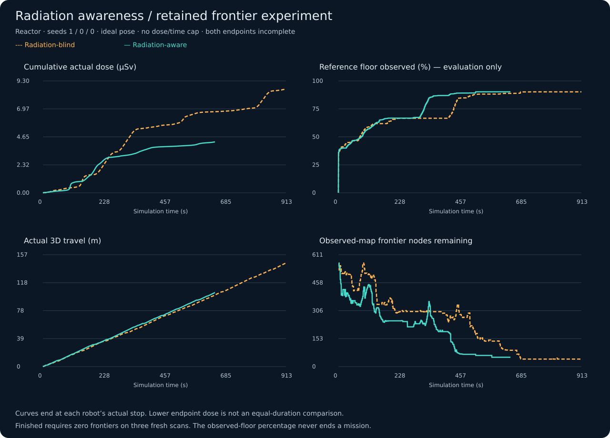
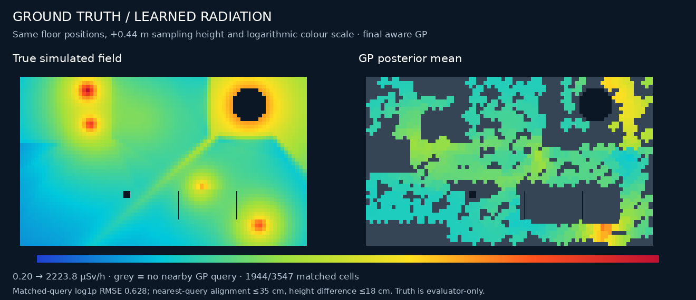

# Current frontier comparison results

One retained paired reactor development experiment; ideal-pose planning comparison, not a multi-seed or hardware validation. Both incomplete outcomes are retained.

Retained run: `comparison_20261109T224031_936791Z`. [Portable data](results/dougie_frontier_comparison.json) · [Raw inputs](results/frontier_comparison_inputs.tar.gz).

## Protocol

Reactor; detector seed 1, sensor seed 0, layout seed 0; 0.5 s fixed simulated planning latency; simulator ground-truth pose; geometry-aware Poisson GP; no cumulative dose cap, no fixed time cap, and soft dose-weighted avoidance. CPU-rendered feeds target 5 FPS.

Finished means zero observed-map frontier nodes confirmed on three fresh scans. A return with unresolved frontiers is incomplete. The reference floor percentage is evaluation-only.

## Endpoints

| Mode | Time (s) | Dose (µSv) | 3D travel (m) | Reference floor | Frontiers | Outcome / reason |
|---|---:|---:|---:|---:|---:|---|
| blind | 913.175 | 8.610373 | 145.068 | 90.25% | 41 | frontiers_blocked / `unresolved_frontiers` |
| aware | 646.510 | 4.231457 | 103.637 | 90.27% | 51 | incomplete_return / `route_tracking_lost` |

Both recorded clean physical returns with zero non-foot contact impulse, but neither completed the frontier objective. Process exit 0 is not a completion claim.

## Matched exploration progress

First retained telemetry sample at or above each reference-floor threshold; different routes/times are retained.

| Reference threshold | Blind dose (µSv) | Aware dose (µSv) | Relative aware dose reduction |
|---|---:|---:|---:|
| 50% | 0.345069 | 0.209989 | 39.1% |
| 75% | 5.546087 | 3.150464 | 43.2% |
| 85% | 5.676865 | 3.251870 | 42.7% |
| 90% | 6.787557 | 3.896284 | 42.6% |

These are within-pair descriptive comparisons, not a confidence interval or general performance estimate. Coverage thresholds summarize a fixed evaluator reference, not the autonomous finish condition.





## Reproduction and provenance

The portable JSON retains all telemetry rows, endpoint status, per-worker configuration and source/asset hashes. The compressed archive retains the original summaries, configurations, survey reports, motion traces, floor/minimap arrays, final renders and radiation map. Figures use those inputs; they are not invented trajectories.

`distance_m` integrates actual 3D base displacement on every physics tick. The historical `path_length_m` diagnostic uses displacement gating and is separately retained. The maps compare true rates at floor +44 cm against the nearest exported GP prediction within 35 cm and 18 cm vertically; missing predictions stay grey. The reported error is only over matched queries.

Full local Go2 verification: **367 passed**. This is separate from remote CI.

```bash
python3 scripts/publish_frontier_comparison.py --check
python3 scripts/publish_frontier_comparison.py
```

Import a complete new run with `--run results/dougie/comparison_<timestamp>`. All paired outcomes must be terminal. Historical six-run smoke results remain in [the October report](results/dougie_comparison_20261027.json).
