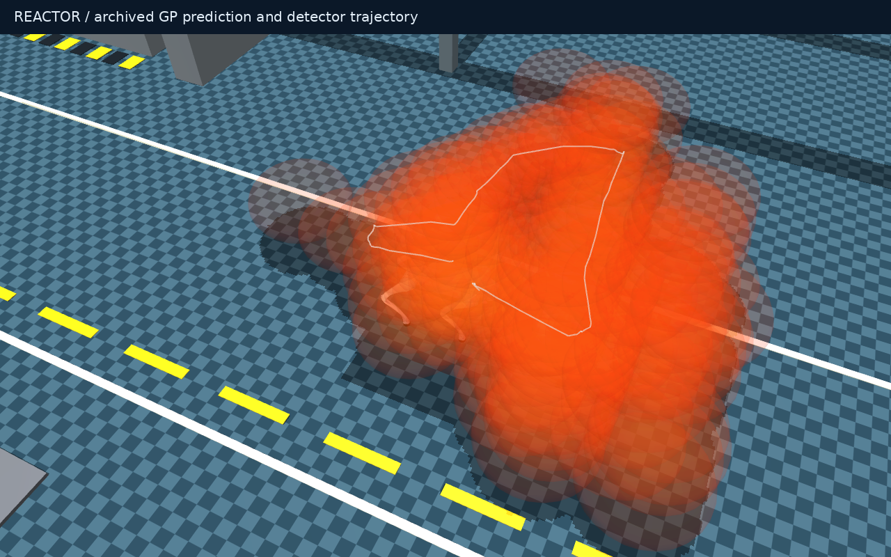
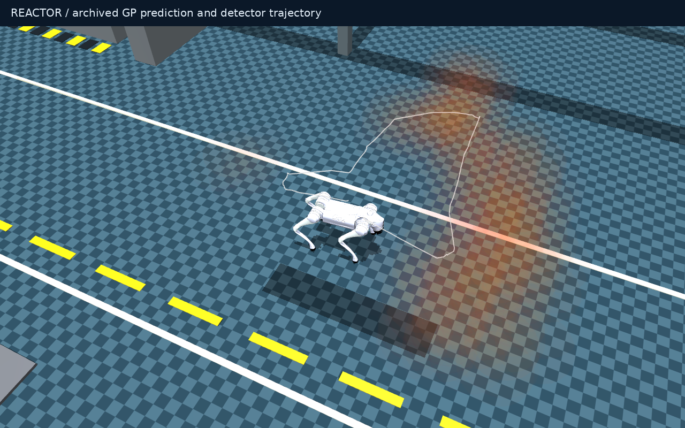

# Continuous, low-opacity radiation display

[Project home](../README.md) · [Onboard methods](DOUGIE_ONBOARD_MISSION.md)

## Before and after

Both images replay the **same archived robot pose, GP posterior queries and
detector evidence**, with the same camera. These are diagnostic renders, not new
missions or an improvement in the inferred radiation field.

| Previous overlapping cloud | Current low-opacity haze |
|---|---|
|  |  |

The old cloud used many .34 × .34 × .22 m-radius ellipsoids at alpha .09.
Overlapping layers accumulated opacity, and uncategorized MuJoCo display geometry
also cast dark shadows. Low alpha on one shape was not enough to keep Go2 visible.

## Changes

- **Smoother coverage:** a full 3 × 3 × 3 local interpolation stencil replaces the
  seven-point cross. Up to eight nearby queries blend in log-rate space, with a
  soft opacity falloff toward the interpolation boundary.
- **Lower opacity:** maximum per-shape alpha is **.018**, down 80% from .09.
  Ellipsoid radii are **.24 × .24 × .16 m**. Actual accumulated opacity still
  depends on viewing direction and overlapping shapes.
- **Robot-aware fading:** an ellipsoidal visibility region around the displayed
  robot smoothly fades the cloud. This changes alpha only; underlying rates,
  uncertainty, measurements, dose forecasts and route decisions are untouched.
- **No artificial cloud shadows:** native MuJoCo cloud shapes are explicitly
  decorative geometry, with subdued material highlights and mild emission.
- **RViz consistency:** eight stable alpha-batched sphere lists implement fading
  because per-point alpha is not reliable for list markers. Empty batches delete
  old points. The fade follows the displayed robot at up to 5 Hz using cached
  interpolated points, rather than rerunning interpolation each refresh.
- **Smaller measurement markers:** RViz count-evidence cubes are .08 m with .65
  marker alpha, retaining measured evidence without dominating the robot view.

The cloud remains bounded at **1,200 points total**, including all RViz opacity
batches. Rendering preserves the existing locality/evidence filter and does not
connect unobserved floors. Native, recorded and RViz views share the same cloud
sizes and interpolation. Current-rate/dose dashboard readings remain visible.

**The visibility fade is not a low-radiation or safe zone.** Blank display space
does not establish absence of radiation; the live legend identifies the fade.

## Verification and reproduction

28 display, live-DDS, landmark and planner/overlay checks passed. Tests cover
posterior immutability, local interpolation, cross-floor separation, duplicate
query invariance, cloud bounds, smooth robot fading, native decorative geometry,
RViz alpha batching, robot motion and stale-marker deletion.

The before/after JSON manifests retain input, overlay-source and image hashes.
The previous image was captured before the display changes; the current renderer
reproduces the after view from the retained archive:

```bash
docker compose run --rm -T -e MUJOCO_GL=egl dougie-sim \
  python3 scripts/render_dougie_reactor.py \
  --run results/dougie/onboard_recorded_routes_seed3 --follow --camera-distance 4 \
  --output docs/media/dougie/field-after.png
```

Start a new `./dougie radiation` session to use the new appearance. No mission
parameter change is required. Historical GIFs retain their captured appearance.
