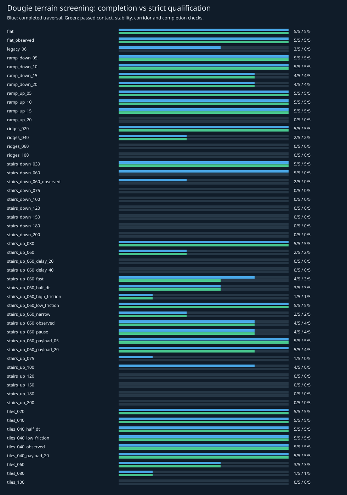

# Go2 terrain qualification

[Project home](../README.md) · [Initial development evidence](DOUGIE_VALIDATION.md)
· [Portable qualification data](results/dougie_terrain_qualification_20261007.json)

## Verdict

**The current walking policy is not qualified for ordinary industrial stairs.**
Completing one small stair demonstration did not establish repeatable or clean
traversal. This study separates crossing a course from passing stricter contact,
stability, physical-validity and completion checks.

There are **680 usable scored trials**: 52 profiles with five screening repeats,
plus seven candidate profiles with 60 fresh holdout repeats each. Twenty original
observed-guidance trials were superseded after correcting a harness finish-goal
error; they remain in the evidence. One held-out failure was replayed serially.
The four earlier pilot runs remain locally available outside these cohorts.

## Scope and protocol

**25 October fixture follow-up:** generated terrain friction parameters are now
set explicitly alongside feet and floor. The pinned feet have higher contact
priority; a [contact-level probe](DOUGIE_TRACTION_SCREEN.md#terrain-parameter-correction-and-contact-priority)
confirms that the previous terrain parameter default did not override requested
foot friction. Historical results and hashes remain unchanged. The new production
stance screen measures effective contact friction in every trial.

This qualifies the pinned `robot_lab` Go2 policy in MuJoCo 3.3.6 with a fixed
20 ms policy period, nominal 5 ms physics timestep and the documented PD/torque
limits. Robot geometry, model/policy downloads, code, scene XML and traces are
fingerprinted. There is no base pinning, runtime pose reset or external force.

Seeds vary initial lateral position (±4 cm), yaw (±5°), joint pose (±0.01 rad),
height (±3 mm) and, for random tiles, the terrain itself. Nominal effective foot
sliding friction is **0.4**. Both foot and floor parameters are controlled;
MuJoCo foot contact priority would otherwise make floor-only friction edits
ineffective. Effective friction is measured from contacts, not assumed.

The acceptance criteria were written before the matrix runs in
[`config/dougie_terrain_protocol.json`](../config/dougie_terrain_protocol.json).
They were not relaxed after observing failures. They require:

- Reaching the specified finish plane inside the test corridor, with a witnessed
  upper landing for ascent, followed by a two-second stop and correct final height.
- No sustained excessive tilt/low clearance, side-corridor exit, or stalled
  progress below 0.1 m over 20 s; the course deadline is 180 s.
- No forceful non-foot contact above 25 N peak or 0.1 N·s accumulated impulse
  from contacts above 1 N. This is an engineering clean-traversal criterion,
  **not a manufacturer-certified damage threshold**.
- No penetration over 3 cm, joint-limit excursion over 0.05 rad, nonfinite state
  or MuJoCo numerical warnings. The torque command stays within ±23.5 N·m.

Foot forces, slip, mechanical work, effective friction, motor saturation and
non-foot contact identities are retained as diagnostics. Data validity means
finite, unrepaired simulated state; it does not prove model fidelity to hardware.

### Guidance and information boundaries

Velocity-guided trials use the same ideal-pose centre-line heading controller
across conditions. The policy sees proprioception and velocity commands, not
terrain heights. Evaluator-only geometric reference heights never enter control.

Observed-guidance trials use the production 3-D range sensor, `SurfaceMap`, and
radiation route follower, with a prescribed goal XY and allowed corridor. Support
heights come only from observed points. Planning is synchronous in simulation
time; this is a best-case navigation test, not a real-time or dose-budget test.

## Independent holdout results

Candidates were selected after screening; their 60 seeds (101–160) were not
used for that selection. The policy was not tuned on holdout results. Each row
has an exact one-sided Clopper–Pearson lower confidence bound. The target was
at least 95% success with 95% confidence **for that row's seeded simulation
distribution**. These are pointwise bounds, not a simultaneous guarantee for
all terrain, models, payloads or real hardware.

| Case | Traversed | Strict passes | Failures | One-sided 95% lower bound | Meets 95% target |
|---|---|---|---|---|---|
| `flat` | 60/60 | 60/60 | None | 95.13% | Yes |
| `ramp_down_10` | 60/60 | 60/60 | None | 95.13% | Yes |
| `ramp_up_10` | 60/60 | 60/60 | None | 95.13% | Yes |
| `stairs_down_030` | 60/60 | 60/60 | None | 95.13% | Yes |
| `stairs_up_030` | 59/60 | 59/60 | locomotion_stall: 1, missing_upper_landing_witness: 1 | 92.34% | No |
| `tiles_020` | 60/60 | 60/60 | None | 95.13% | Yes |
| `tiles_040` | 57/60 | 57/60 | locomotion_stall: 3 | 87.58% | No |

The 3 cm ascent stalled once (seed 154); 4 cm random tiles stalled three times
(seeds 126, 139 and 159). They therefore fail the stated repeatability target
despite high completion fractions. Flat ground, the tested 2 cm tile distribution,
3 cm descent and the two tested 10° ramp courses each passed 60/60, giving a
95.13% pointwise lower bound. “10° ramps” refers to these courses, not every slope
up to 10°; “2 cm tiles” refers to the generated 25 cm-wide cells.

## Stair findings

- At 6 cm rise / 40 cm tread, nominal velocity-guided ascent passed only **2/5**.
  Descent crossed **5/5** but passed **0/5** clean-traversal checks due to calf
  strikes. The original combined staircase crossed **3/5**, with no strict passes.
- All **30 trials** across 15, 18 and 20 cm industrial-sized risers (both directions)
  failed to complete. Stalls, non-foot impacts and joint-limit excursions are
  visible in the raw evidence. The controller is not demonstrated to climb these.
- Results are non-monotonic: some 10 cm ascents completed while smaller steps
  stalled. A single “maximum step height” is therefore an inadequate capability model.
- Lower friction and a small added payload sometimes improved ascent in the
  five-run screening. This is sensitivity, not justification to change simulated
  friction or mass to manufacture a pass.
- A 20 ms observation delay produced 0/5 clean passes on the nominal 6 cm ascent;
  40 ms also caused stronger contact/joint/corridor failures. The policy is latency-sensitive.
- Halving the physics timestep while keeping the policy at 50 Hz changed some
  marginal stair outcomes. Stable broad qualification cannot be inferred from
  one timestep and initial gait phase.

## Observed-route findings and harness correction

The first observed-mode goal was placed on the finish plane. The production
follower correctly stopped within its waypoint tolerance, but the evaluator
required crossing the plane. Flat-ground traces revealed this mismatch.
The correction moves the **goal** 0.5 m beyond the same finish plane, as in
velocity guidance; neither the plane nor the acceptance criteria changed.
All four observed profiles were rerun, including failures. Their original
20 records are retained as superseded harness-development data.

After correction, flat and 4 cm tiles passed 5/5. Observed 6 cm ascent passed
4/5; descent completed 2/5 and passed 0/5. Thus sensed-path integration does not
resolve the underlying stair-descent limitation. Five repeats do not meet the
60-run repeatability standard, even where every run passed.

## Complete screening matrix

“Traversed” records valid completion; “strict passes” additionally apply the
contact/joint/penetration/settling criteria. The corrected observed rows replace
the superseded rows here; both versions are retained in the JSON.



| Case | Traversed | Strict passes | Failures |
|---|---|---|---|
| `flat` | 5/5 | 5/5 | None |
| `flat_observed` | 5/5 | 5/5 | None |
| `legacy_06` | 3/5 | 0/5 | nonfoot_impact: 3, locomotion_stall: 2, missing_upper_landing_witness: 2 |
| `ramp_down_05` | 5/5 | 5/5 | None |
| `ramp_down_10` | 5/5 | 5/5 | None |
| `ramp_down_15` | 4/5 | 4/5 | locomotion_stall: 1 |
| `ramp_down_20` | 4/5 | 4/5 | locomotion_stall: 1 |
| `ramp_up_05` | 5/5 | 5/5 | None |
| `ramp_up_10` | 5/5 | 5/5 | None |
| `ramp_up_15` | 5/5 | 5/5 | None |
| `ramp_up_20` | 0/5 | 0/5 | locomotion_stall: 5, missing_upper_landing_witness: 5 |
| `ridges_020` | 5/5 | 5/5 | None |
| `ridges_040` | 2/5 | 2/5 | locomotion_stall: 3 |
| `ridges_060` | 0/5 | 0/5 | locomotion_stall: 5 |
| `ridges_100` | 0/5 | 0/5 | locomotion_stall: 5, nonfoot_impact: 5 |
| `stairs_down_030` | 5/5 | 5/5 | None |
| `stairs_down_060` | 5/5 | 0/5 | nonfoot_impact: 5 |
| `stairs_down_060_observed` | 2/5 | 0/5 | nonfoot_impact: 4, observed_route_stall: 3 |
| `stairs_down_075` | 0/5 | 0/5 | locomotion_stall: 5, nonfoot_impact: 5 |
| `stairs_down_100` | 0/5 | 0/5 | locomotion_stall: 5, nonfoot_impact: 5 |
| `stairs_down_120` | 0/5 | 0/5 | locomotion_stall: 5, nonfoot_impact: 5 |
| `stairs_down_150` | 0/5 | 0/5 | locomotion_stall: 5, nonfoot_impact: 5, joint_limit_violation: 3 |
| `stairs_down_180` | 0/5 | 0/5 | locomotion_stall: 5, nonfoot_impact: 5 |
| `stairs_down_200` | 0/5 | 0/5 | locomotion_stall: 5, nonfoot_impact: 5 |
| `stairs_up_030` | 5/5 | 5/5 | None |
| `stairs_up_060` | 2/5 | 2/5 | locomotion_stall: 3, missing_upper_landing_witness: 3 |
| `stairs_up_060_delay_20` | 0/5 | 0/5 | locomotion_stall: 5, missing_upper_landing_witness: 5, nonfoot_impact: 2 |
| `stairs_up_060_delay_40` | 0/5 | 0/5 | excessive_penetration: 5, joint_limit_violation: 5, left_test_corridor: 2, missing_upper_landing_witness: 5, nonfoot_impact: 5, locomotion_stall: 3 |
| `stairs_up_060_fast` | 4/5 | 3/5 | joint_limit_violation: 1, locomotion_stall: 1, missing_upper_landing_witness: 1 |
| `stairs_up_060_half_dt` | 3/5 | 3/5 | locomotion_stall: 2, missing_upper_landing_witness: 2 |
| `stairs_up_060_high_friction` | 1/5 | 1/5 | locomotion_stall: 4, missing_upper_landing_witness: 4 |
| `stairs_up_060_low_friction` | 5/5 | 5/5 | None |
| `stairs_up_060_narrow` | 2/5 | 2/5 | locomotion_stall: 3, missing_upper_landing_witness: 3 |
| `stairs_up_060_observed` | 4/5 | 4/5 | missing_upper_landing_witness: 1, observed_route_stall: 1 |
| `stairs_up_060_pause` | 4/5 | 4/5 | locomotion_stall: 1, missing_upper_landing_witness: 1 |
| `stairs_up_060_payload_05` | 5/5 | 5/5 | None |
| `stairs_up_060_payload_20` | 5/5 | 4/5 | nonfoot_impact: 1 |
| `stairs_up_075` | 1/5 | 0/5 | locomotion_stall: 4, missing_upper_landing_witness: 4, nonfoot_impact: 1 |
| `stairs_up_100` | 4/5 | 0/5 | joint_limit_violation: 2, nonfoot_impact: 4, locomotion_stall: 1, missing_upper_landing_witness: 1, excessive_penetration: 1 |
| `stairs_up_120` | 0/5 | 0/5 | excessive_penetration: 2, joint_limit_violation: 2, locomotion_stall: 5, missing_upper_landing_witness: 5, nonfoot_impact: 2 |
| `stairs_up_150` | 0/5 | 0/5 | locomotion_stall: 5, missing_upper_landing_witness: 5, joint_limit_violation: 3 |
| `stairs_up_180` | 0/5 | 0/5 | locomotion_stall: 5, missing_upper_landing_witness: 5, nonfoot_impact: 5, joint_limit_violation: 3 |
| `stairs_up_200` | 0/5 | 0/5 | locomotion_stall: 5, missing_upper_landing_witness: 5, nonfoot_impact: 5, joint_limit_violation: 2 |
| `tiles_020` | 5/5 | 5/5 | None |
| `tiles_040` | 5/5 | 5/5 | None |
| `tiles_040_half_dt` | 5/5 | 5/5 | None |
| `tiles_040_low_friction` | 5/5 | 5/5 | None |
| `tiles_040_observed` | 5/5 | 5/5 | None |
| `tiles_040_payload_20` | 5/5 | 5/5 | None |
| `tiles_060` | 3/5 | 3/5 | locomotion_stall: 2 |
| `tiles_080` | 1/5 | 1/5 | locomotion_stall: 4, nonfoot_impact: 1 |
| `tiles_100` | 0/5 | 0/5 | locomotion_stall: 5, nonfoot_impact: 3 |

## Reproduce and inspect

Run from the Dougie-Sim root:

```bash
./dougie terrain-qualify --list
./dougie terrain-qualify --suite matrix --workers 6
./dougie terrain-qualify --suite repeatability --workers 6
./dougie terrain-qualify --cases stairs_down_060 --seeds 0 --workers 1 --view
```

An experiment run exits successfully when it produced valid evidence, even if
the robot failed. Add `--require-qualified` to turn any strict failure into a
nonzero exit. Harness errors or incomplete evidence are not counted as success.
Existing output directories are rejected rather than overwritten.

Each run retains `request.json`, `scene.xml`, `result.json`, and a compressed
20 Hz `trace.npz` of time, root/joint state, torques and commands. Metrics inspect
contacts every physics step. Per-cohort manifests and summaries record every
requested case/seed. The report generator checks completeness, duplicate trials,
source identity and artifact hashes before exporting results:

```bash
docker compose run --rm -T dougie-sim python3 scripts/report_dougie_terrain.py
```

The serial replay of the held-out 3 cm ascent failure reproduced its reasons
and terminal joint/root state to 1e-12. Full raw traces are under ignored
`results/dougie/terrain_*`; the portable JSON includes their hashes and per-run metrics.
Each cohort also has a `source_snapshot.tar.gz` assembled at report time. All
source bytes match its original manifest. The superseded v1 harness was
reconstructed by reversing the documented goal/default-suite changes and was
accepted only after its SHA-256 matched the original; this is recorded explicitly.
The dated report exporter refuses different outcome counts rather than copying
stale conclusions onto new experiments.

## Engineering conclusion

The prior 6 cm staircase and 2–4 cm plate demonstrations remain observations of
completion, not broad terrain qualification. The radiation planner's 7.5 cm
edge-admission threshold is a geometry heuristic, not a validated locomotion
envelope. No planner limit or physical acceptance threshold was widened here.

The next capability gate is a terrain-trained/perceptive walking or stepping
controller with explicit swing-foot clearance and controlled descent, followed
by independent held-out qualification. Training should include riser/tread
variation, downward edges, roughness wavelength, realistic friction, sensor
payloads and observation delay. Repeat the contact-aware tests before claiming
industrial stairs or deploying dose-constrained multi-floor missions.

This study does not cover real hardware, damaged/open-riser stairs, cross-slopes,
loose rubble, wet surface physics, pushes, battery exhaustion or arbitrary
payloads. It establishes specific simulated operating limits and failures,
not universal terrain capability.
