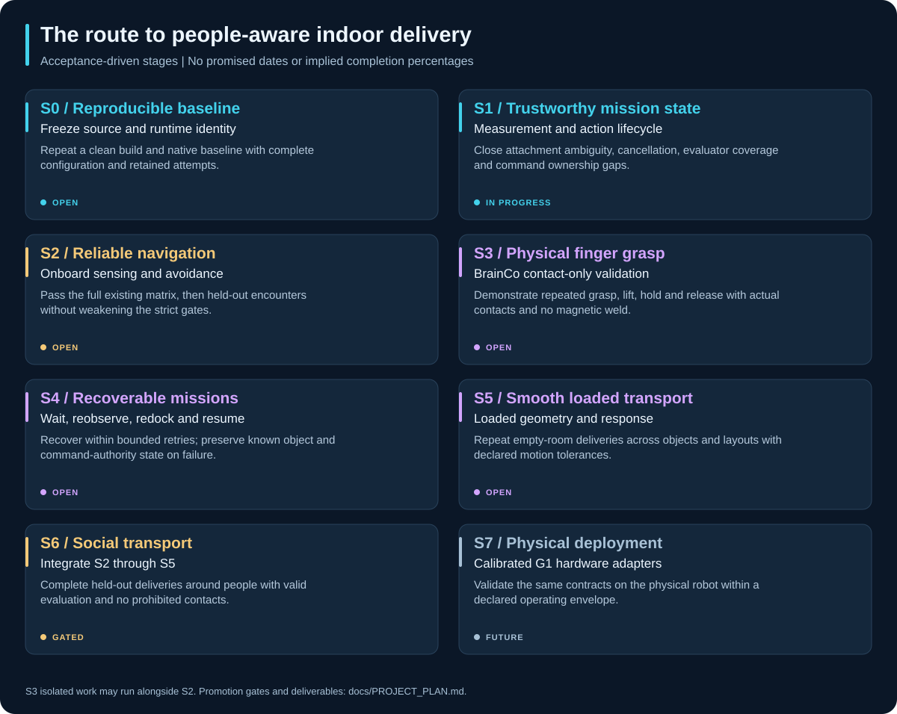

# Project plan: from research prototype to indoor delivery

<!-- geoff-nav:start -->
<p align="center">
  <a href="../README.md"></a>
  <a href="../README.md#quick-start"></a>
  <a href="DEMO_GUIDE.md"></a>
  <a href="INDEX.md"></a>
  <a href="REPOSITORY_GUIDE.md"></a>
  <br>
  <a href="PROJECT_STATUS.md"></a>
  <a href="PROJECT_PLAN.md"></a>
  <a href="RESULTS_REVIEW.md"></a>
  <a href="literature_review/README.md"></a>
  <a href="DEVELOPMENT.md"></a>
</p>
<!-- geoff-nav:end -->

Related: [Technical implementation roadmap](SOCIAL_LOCOMANIPULATION_ROADMAP.md).

**Planning snapshot: 5 October 2026.** The target is repeated, sensor-driven
table-to-table delivery by a Unitree G1 with BrainCo hands in a declared indoor
operating environment. The robot should navigate around people, grasp and carry
an object, verify placement and recover from ordinary disturbances.

This page organizes the active technical roadmap into reviewable work packages.
It does not assign unconfirmed owners or promise dates. An item is complete only
when its stated evidence exists; source implementation, unit coverage, native
integration and acceptance are separate milestones.



## Planning principles

- Freeze a candidate before collecting acceptance evidence; retain failed and
  invalid attempts and identify all changed conditions.
- Keep simulator truth in training/evaluation and explicitly labelled oracle
  diagnostics, outside onboard mission decisions.
- Keep contact-only grasping distinct from magnetic attachment fixtures.
- Use measured response and loaded geometry to judge executable motion.
- Maintain the existing strict navigation thresholds. A selected successful
  episode or unit-test pass cannot promote an entire stage.

## Dependency and workstream map

```text
S0 Reproducible baseline + S1 Measurement / lifecycle correctness
  ├── S2 Reliable onboard navigation
  ├── S3 BrainCo contact-only grasping (isolated work can proceed alongside S2)
  └── S4 Recoverable mission architecture
          └── S5 Smooth loaded transport (integrates manipulation and recovery)

S2 + S3 + S4 + S5 accepted → S6 People-aware delivery → S7 Physical deployment
```

This is a promotion dependency, not a prohibition on isolated research. Native
fixture experiments and hand benches can inform later stages while navigation
acceptance remains open.

## Stage deliverables and exit evidence

### S0 — Reproducible baseline · Open

**Goal:** another developer can reconstruct the measured candidate and determine
which source and configuration actually ran.

- **S0.1 Source snapshot:** reconcile the parent commit, pinned submodules,
  patch manifests, generated models, configuration and policy hash.
- **S0.2 Runtime identity:** capture loaded module paths, installed-code hashes,
  binary/image identity and effective launch/profile parameters.
- **S0.3 Reproduction:** perform a clean build and repeat a declared native baseline;
  retain command, environment, outputs and every attempt.

**Deliverable:** a reproduction report plus source/runtime manifests and artifact
index. **Exit evidence:** the clean rebuild matches the intended snapshot and
reproduces the declared baseline within explicitly stated timing/metric tolerances.
The October build/patch checks are progress toward this gate, not its completion.

**Start in:** `patches/`, `scripts/transport_evidence.py`, Docker, build scripts
and [development](DEVELOPMENT.md).

### S1 — Measurement and lifecycle correctness · In progress

**Goal:** mission success, object possession and termination are reported truthfully
under timeouts, dropped updates and asynchronous action/service races.

- **S1.1 Possession and release:** test `empty`/`uncertain`/`held` transitions;
  require post-release observations and independently justified support/placement.
- **S1.2 Action termination:** cancel and await terminal state even after the
  mission deadline; exercise late acknowledgements, rejected cancellation and shutdown.
- **S1.3 Evaluation coverage:** latch stream gaps/clock regressions, reject stale
  final-only success, and add actual contact coverage for arms, payload and scene.
- **S1.4 Authority and response:** verify command ownership and measure sensing,
  planning, actuation and stopping behavior under the intended workload.

**Deliverable:** fault-injection matrix, lifecycle contracts, calibration records
and native traces. **Exit evidence:** false success is rejected, termination is
bounded, known/unknown possession is preserved and measurement coverage supports
the claims being scored. Published helpers and regression tests cover portions
of this work; the complete gate remains open.

**Start in:** bridge transport/action/health modules, arm compositor, manipulation
I/O, benchmark source contracts and [calibration](TRAINING_AND_CALIBRATION.md).

### S2 — Reliable onboard navigation · Open

**Goal:** complete goals around people with valid sensing and no prohibited contacts.

- **S2.1 Reproduce failures:** replay the v85 audited encounters; align predicted
  and measured robot/person motion on acquisition timestamps.
- **S2.2 Isolate causes:** distinguish missed/partial tracks, response-model error,
  candidate selection, supervisor vetoes, route changes and latency.
- **S2.3 Implement bounded corrections:** share executable-motion contracts,
  improve early avoidance and side commitment, account for occlusion and profile cost.
- **S2.4 Promote a frozen candidate:** run the complete six-world/three-seed
  development matrix, followed by declared held-out seeds and encounters.

**Deliverable:** failure analyses, controlled comparisons and complete datasets.
**Exit evidence:** every requested goal and strict validator check passes in the
development matrix, then the defined held-out protocol passes without changing
thresholds. Keep timing and world/count/budget differences explicit.

**Start in:** bridge tracking/planning/supervision, bringup profiles,
`run_avoidance_matrix.py` and [the investigation](NAVIGATION_RELIABILITY_INVESTIGATION.md).

### S3 — BrainCo physical grasp · Open

**Goal:** establish a real contact-based grasp model suitable for mobile integration.

- **S3.1 Declare the contract:** exact hand/API, channel mapping, joint coupling,
  limits, geometry, friction assumptions and supported object dimensions/masses.
- **S3.2 Calibrate the isolated bench:** repeat grasp/lift/hold/release using contact
  physics only, with offset, material and perturbation variation.
- **S3.3 Add arm approach:** check the arm/table/hand swept geometry and measured
  grasp evidence; reconcile the bench's 5 cm object with the 11 cm transport fixture.

**Deliverable:** hand calibration, test matrix and repeatable contact-only traces.
**Exit evidence:** repeated physical grasps without weld attachment or unintended
contacts across the declared variation; compare against the real hand when available.

**Start in:** description assets, `brainco_hand_model.py`, native hand helper,
`measure_brainco_contact_grasp.py` and [MoveIt configuration](../ros2_ws/src/g1_moveit_config/README.md).

### S4 — Recoverable mission · Open

**Goal:** one persistent mission lifecycle resumes recoverable tasks and preserves
known state when recovery is exhausted.

- **S4.1 Consolidate the two paths:** define common navigation/docking/manipulation
  action contracts for the older MoveIt stack and newer transport implementation.
- **S4.2 Recovery states:** wait, reobserve, redock, regrasp, replan and safe hold,
  with explicit retry budgets, cancellation and recoverable checkpoints.
- **S4.3 Scene changes:** reproject targets after base motion; verify destination
  occupancy and support translational search rather than indefinite turning.

**Deliverable:** state-machine specification and injected-disturbance scenarios.
**Exit evidence:** recoverable faults resume without a mission restart; unrecoverable
faults terminate within bounds while preserving possession and authority state.

**Start in:** bridge transport modules, `g1_task_orchestration`, `g1_locomotion`
and `g1_manipulation`. Unit-tested helpers are inputs to this integration gate.

### S5 — Smooth loaded transport · Open

**Goal:** stable, collision-aware empty-room deliveries with explicit motion quality.

- **S5.1 Loaded geometry:** include actual articulated arm/payload swept volume
  and transitions between reach/carry/rest postures.
- **S5.2 Response coverage:** measure reverse, lateral, turning and stopping
  behavior across loads, poses, delays and dynamics variation.
- **S5.3 Mission integration:** precision docking, placement, retreat and authority
  restoration; evaluate on the intended compute budget.

**Deliverable:** loaded-response dataset and repeated empty-room mission cohort.
**Exit evidence:** full deliveries across declared layouts/objects with no falls,
drops, unintended contacts or resets, meeting predeclared motion/placement tolerances.
The two cycle-01 fixture passes are exploratory evidence toward this broader gate.

**Start in:** `g1_payload_training.py`, arm kinematics/composition, transport
fixtures and [payload evidence](PAYLOAD_POLICY_TRAINING.md).

### S6 — Social transport · Gated on S2–S5

**Goal:** integrate reliable navigation, grasping and recovery around people.

- Define crossings, head-on/overtaking, narrow openings, occluded emergence,
  workspace intrusion, occupied destinations and repeated multi-delivery tasks.
- Predeclare development/held-out conditions and intervention accounting.
- Measure delivery completion, valid sensing, contacts, yielding/resumption,
  deadlock, passing clearance, front cuts and human delay.

**Deliverable:** complete social-delivery cohort, replayable failures and a report.
**Exit evidence:** held-out full deliveries meet the agreed mission and human-aware
behavior criteria, with zero prohibited contacts, falls or drops and valid evaluation.

### S7 — Physical deployment · Future

**Goal:** validate the same software contracts on a calibrated physical G1.

- Declare exact robot/hand/sensor/compute configuration and indoor operating limits.
- Implement hardware adapters, timing/actuation bounds and independent stop/watchdog behavior.
- Progress from supported motion to unloaded locomotion, grasping, loaded delivery
  and controlled encounters, retaining evidence at each step.

**Deliverable:** hardware integration and operating-envelope report.
**Exit evidence:** the relevant acceptance suite passes on the physical system.
Simulation or interface compatibility alone does not satisfy this gate.

## Next review cycle

### Reactivity workstream

The technical roadmap also breaks response work into
[R1–R6](SOCIAL_LOCOMANIPULATION_ROADMAP.md#reactive-simulation-workstream-s1-s2-s4-and-s5).
These refine the stages above; they are planned work rather than additional
acceptance claims.

| Work package | Stage | Intended output |
| --- | --- | --- |
| R1 End-to-end response baseline | S1 | Acquisition-to-command and command-to-motion timing, stopping and load traces |
| R2 Command ownership/interruption | S1 | Explicit ownership leases, stale-command rejection and bounded cancel/stop propagation |
| R3 Independent fast collision response | S2 | Profiled immediate checks separated from expensive planning; measured timing tails |
| R4 Backend and physical-response comparison | S1/S5 | Matched policy-contract, unloaded/loaded onset, stopping and balance evidence |
| R5 Occlusion/state-estimation robustness | S2 | Acquisition-time alignment, uncertainty and controlled estimator/predictor comparisons |
| R6 Interruptible persistent skills | S4 | Shared lifecycle and recovery under cancel, perception loss and scene changes |

Start with R1/R2 after the current correctness work, then use measurements to
prioritize R3/R4 and sensing-related R5 changes. Feed the resulting contracts into
R6 and loaded/social acceptance. Candidate execution rates and alternative
backends in the technical plan are hypotheses to evaluate, not validated defaults.

### Immediate review outputs

| Priority | Reviewable output | Decision it enables |
| --- | --- | --- |
| 1 | S0 candidate manifest and clean-build/native reproduction report | Which exact baseline to compare against |
| 2 | S1 fault matrix and remaining coverage gaps | Which mission results are trustworthy |
| 3 | S2 audited failure reproduction and single-factor experiment | Which navigation change to retain |
| 4 | S3 hand/object contract and isolated contact-only tests | Whether grasp work can enter mobile integration |
| 5 | S4 shared lifecycle design and S5 loaded-response protocol | How to integrate recovery and payload motion |

Assign an owner and link an issue/PR when starting a work package. No owner or
deadline is implied by this planning table. Review after meaningful experiments
or source publications; report blocked work and failed hypotheses as progress
in understanding the system.

## Keeping the project current

For every published milestone:

1. Record source, policy, configuration and artifact identity.
2. Add a dated result with successes, failures, invalid attempts and limitations.
3. Update [PROJECT_STATUS.md](PROJECT_STATUS.md): current snapshot, evidence and blockers.
4. Update this plan and the [technical ledger](SOCIAL_LOCOMANIPULATION_ROADMAP.md)
   only when a deliverable or promotion criterion changes.
5. Update affected package READMEs, public commands and the folder guide.
6. Regenerate graphics if folder structure, timeline or stage labels changed;
   run documentation/graphics checks and review the rendered pages.
7. Link the published commit and issue/PR so readers can trace the change.

Use the following entry format in experiment reports or linked issues:

```text
Date / work package / owner:
Source and runtime identity:
Change and question being tested:
Verification or experiment conditions:
Measured outcome, including failures:
Artifact links:
Gate impact: unchanged / progressed / satisfied (with evidence):
Next action and blocker:
```

The status page is the public summary; experiment reports are the detailed
record. The README links to both. Historical reports remain dated rather than
being silently updated to describe newer code.
