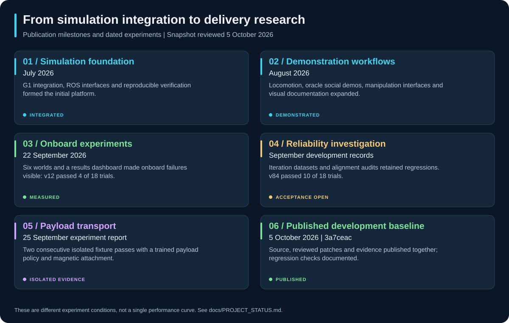

# Project status and progression

<!-- geoff-nav:start -->

  
  
  
  
  
   
  
  
  
  
  

<!-- geoff-nav:end -->

**Last reviewed: 5 October 2026.** This page summarizes the published development
baseline [`3a7ceac`](https://github.com/DavidBatty95/Geoff-Sim/commit/3a7ceac).
It is a manually maintained evidence snapshot, not a live view of local work or
an acceptance release. Later commits and local experiments need their own checks.

## At a glance

| Area | Current state | What remains |
| --- | --- | --- |
| Simulation and demos | Integrated ROS 2/MuJoCo stack, onboard visual sessions, six representative worlds and results GUI | Repeated clean-checkout/native reproduction and longer uninterrupted evidence |
| Onboard navigation | Sensor-derived localization, mapping, person tracking and planning implemented | All-pass full matrix and held-out acceptance; contacts still occur |
| Payload transport | Experimental sensor-driven pickup/carry/place; two consecutive zero-person fixture passes | Repeatability, broader conditions, actual finger grasp and crowd integration |
| Mission correctness | Attachment-state, action-termination, health and provenance helpers published | Complete lifecycle/coverage qualification and integrated recovery |
| BrainCo hands | Description, interfaces and experimental contact-bench work | Repeated mobile contact-only grasp validation |
| Research | 50-work literature-review package, published trials and retained failure ledger | Controlled comparisons, held-out experiments and stronger reliability estimates |
| Hardware | Physical G1 is the target | Calibrated deployment and hardware acceptance remain future work |

## Current evidence

| Snapshot | Recorded outcome | Scope |
| --- | --- | --- |
| [Published v12 cohort](DEMO_RESULTS.md) | 4/18 strict passes; 19/54 goals; 12 contacts | Six representative worlds, four people and three requested goals per trial |
| [Consolidated v82](results/avoidance_v82_matrix.json) | 14/18 strict passes; 49/54 goals; four contacts | Investigation configuration; not a release acceptance pass |
| [Later full v84 matrix](results/avoidance_v84_matrix.json) | 10/18 strict passes; 46/54 goals; six contacts | Latest retained complete matrix in the assessed baseline |
| [Targeted v85 audit](results/avoidance_v85_alignment_audit.json) | Geometric overlap confirmed in both audited courtyard failures | Alignment diagnostic, not a new full matrix |
| [Payload cycle 01](PAYLOAD_POLICY_TRAINING.md) | Two consecutive complete zero-person native runs; 2 complete passes among 11 recorded candidate attempts | Earlier attempts used evolving integration code; magnetic attachment, not finger-force closure |
| [Publication checks](DEVELOPMENT.md#publication-verification--5-october-2026) | 15 ROS packages built; 333 bridge, 83 benchmark, 18 bringup, 79 script, 7 training tests; 10 simulator CTests passed | Software/build evidence from the development environment |

The best observed complete navigation matrices reached 16/18 strict passes, but
no all-pass release matrix or held-out acceptance is established. The later v84
regression is retained rather than replacing it with a best-case snapshot.
Matched seeds do not guarantee identical timing or observed-free goal selection.

The published default dashboard dataset remains the v12 publication snapshot.
Use the selector or explicit dataset paths to inspect later iterations. A higher
filename version does not mean a better or qualified controller. See
[results review](RESULTS_REVIEW.md) for denominators and provenance.

## Project progression

Publication dates and experiment dates are different. Commits identify published
source; dated reports identify measurements performed on their recorded setup.

| Date / phase | Progress | Evidence to follow |
| --- | --- | --- |
| July 2026 — integration | Simulator/ROS integration and verification foundation | [Integration checkpoint `3dd33d4`](https://github.com/DavidBatty95/Geoff-Sim/commit/3dd33d4) |
| August 2026 — runnable workflows | Locomotion/social demonstrations and manipulation workflows; oracle modes explicitly separated | [Workflow publication `1e98ba4`](https://github.com/DavidBatty95/Geoff-Sim/commit/1e98ba4), [suite reference](DEMO_SUITE.md) |
| 22 September 2026 — inspectable experiments | Six representative worlds, dashboard, portable benchmark evidence and transport plan | [Worlds/dashboard `7c4cd3e`](https://github.com/DavidBatty95/Geoff-Sim/commit/7c4cd3e), [evidence publication `886abb2`](https://github.com/DavidBatty95/Geoff-Sim/commit/886abb2) |
| September development records — reliability investigation | Tracking, response, candidate-search and supervision corrections; failed pilots retained | [Investigation ledger](NAVIGATION_RELIABILITY_INVESTIGATION.md), [transport-plan history](TRANSPORT_DEMO_PLAN.md) |
| 25 September experiment report — payload fixture | Payload-aware fine-tuning and two consecutive unpinned fixture completions | [Training cycle, interventions and attempts](PAYLOAD_POLICY_TRAINING.md) |
| 5 October 2026 — publication baseline | Expanded documentation, source/patch publication, transport helpers and regression verification | [Documentation `94c72be`](https://github.com/DavidBatty95/Geoff-Sim/commit/94c72be), [source `3a7ceac`](https://github.com/DavidBatty95/Geoff-Sim/commit/3a7ceac) |

## Current priorities

1. **Reproduce the baseline (S0):** freeze source, patches, policy and runtime
   identity; repeat a clean build and a native baseline with complete artifacts.
2. **Qualify mission correctness (S1):** verify uncertain possession, terminal
   cancellation, continuous evaluator coverage, contact accounting and authority.
3. **Close navigation failures (S2):** reproduce audited encounters, isolate the
   sensing/model/planning/execution contribution, then validate full and held-out cohorts.
4. **Develop physical grasping (S3):** use contact-only hand experiments with
   declared object geometry and perturbations; keep magnetic fixtures labelled.
5. **Integrate recovery and loaded motion (S4/S5):** consolidate mission paths,
   verify swept geometry and measure loaded tracking/stopping before crowd promotion.

The [forward plan](PROJECT_PLAN.md) gives deliverables and exit criteria. Individual
components may progress in parallel; the end-to-end acceptance dependencies still apply.

## What the current publication does not establish

- Reliable collision-free navigation across development and unseen conditions.
- Crowd transport, contact-only mobile finger grasping or physical G1 deployment.
- An uninterrupted 30-minute endurance run from short GIFs or restarting sessions.
- A causal improvement from RL alone: initialization and integration changes also
  contributed to the documented payload experiment.
- A fresh acceptance result for every later local source change.

These are evidence boundaries that drive the next experiments, not reasons to
hide failed trials. Follow [the plan's promotion gates](PROJECT_PLAN.md#stage-deliverables-and-exit-evidence).

## Following updates

- Read this page for the current assessed snapshot and changed blockers.
- Read [the project plan](PROJECT_PLAN.md) for the next deliverables.
- Use [GitHub commits](https://github.com/DavidBatty95/Geoff-Sim/commits/main)
  for publication history and [Actions](https://github.com/DavidBatty95/Geoff-Sim/actions/workflows/verification.yml)
  for actual CI outcomes; the test counts above are not a claim about every CI run.
- Use [issues](https://github.com/DavidBatty95/Geoff-Sim/issues) to discuss or take
  ownership of a work package. Planning items here are not automatically created issues.

Update this page when a published milestone or measured outcome changes the
assessment. Keep old reports intact and link new evidence rather than rewriting
historical results. The [update checklist](PROJECT_PLAN.md#keeping-the-project-current)
defines the maintenance process.
