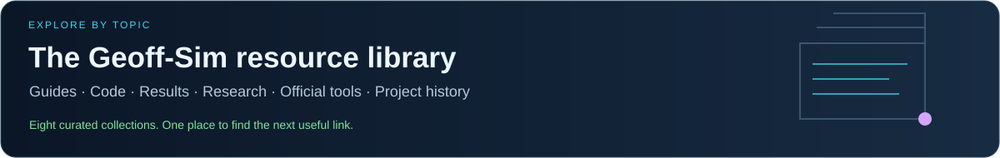

# Geoff-Sim documentation

<!-- geoff-nav:start -->

  
  
  
  
  
   
  
  
  
  
  

<!-- geoff-nav:end -->

## Pick a reading path

The [resource library](resources/README.md) provides a topic-based way to explore
guides, source code, results, research papers, upstream documentation and history.

| Reader | Recommended path |
| --- | --- |
| First-time visitor | [Project status](PROJECT_STATUS.md) → [recorded gallery](../README.md#recorded-demo-gallery) → [demo walkthrough](DEMO_GUIDE.md) |
| Demo operator | [Installation](../README.md#quick-start) → [visual runbook](ONBOARD_VISUAL_DEMO.md) → [suite reference](DEMO_SUITE.md) |
| Developer | [Repository guide](REPOSITORY_GUIDE.md) → [architecture](ARCHITECTURE.md) → [development checks](DEVELOPMENT.md) |
| Hardware-interface developer | [Fidelity contract](HARDWARE_FIDELITY.md) → [native payload contract](NATIVE_PAYLOAD_CONTRACT.md) → [validation](DEVELOPMENT.md) |
| Researcher or reviewer | [Results review](RESULTS_REVIEW.md) → [datasets](results/README.md) → [literature review](literature_review/README.md) |
| Project contributor | [Forward plan](PROJECT_PLAN.md) → [technical roadmap](SOCIAL_LOCOMANIPULATION_ROADMAP.md) → [contributing](../CONTRIBUTING.md) |

## Keep up to date

- [Project status](PROJECT_STATUS.md) is the dated overview of published work,
  measured outcomes and remaining limitations.
- [Project plan](PROJECT_PLAN.md) turns the technical roadmap into deliverables,
  dependencies and completion evidence.
- [Documentation index](INDEX.md) links every maintained topic guide.
- [Development](DEVELOPMENT.md) records verification scope; experiment reports
  keep their original dates and configurations.

The README GIFs are recorded visual sessions. Diagrams are explanatory
schematics. Scored results, oracle diagnostics, mock tests and unscored visuals
have different meanings; [results review](RESULTS_REVIEW.md) explains the distinction.
