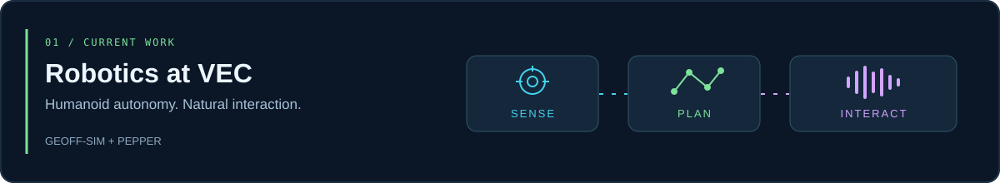
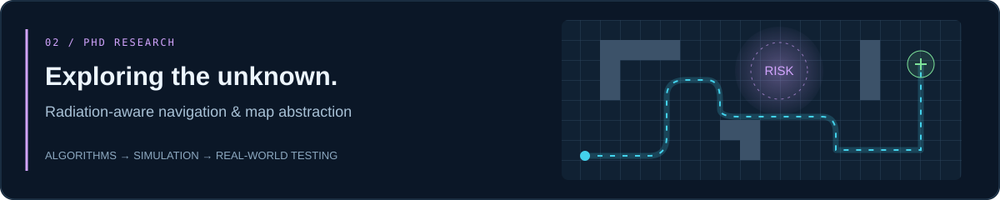

  

  <h3>Engineering robots that perceive, explore and interact.</h3>

  
Autonomous systems · Human-aware navigation · Research-led engineering

  

    <a href="#current-work--vec">Current work · VEC</a> &nbsp; / &nbsp;
    <a href="#phd-research">PhD research</a> &nbsp; / &nbsp;
    <a href="#web-development">Web development</a> &nbsp; / &nbsp;
    <a href="https://github.com/DavidBatty95/Geoff-Sim">Geoff-Sim</a> &nbsp; / &nbsp;
    <a href="mailto:dwbatty@liverpool.ac.uk">Get in touch</a>
  

---

## Hi, I'm David

I'm a **robotics engineer** working across autonomous exploration, robot simulation and human–robot interaction. My work connects **PhD research into radiation-aware navigation** with practical robotics at the **Virtual Engineering Centre (VEC), University of Liverpool**.

I build the software that connects sensing, decision-making and robot behaviour — from occupancy-map abstraction and quadruped exploration to humanoid navigation and conversational robots.

## Current work · VEC

### Geoff-Sim / humanoid autonomy

A **Unitree G1 simulation research platform** built with MuJoCo and ROS 2: bringing locomotion, onboard perception and human-aware navigation into one experimental system.

- **Perceive:** simulated LiDAR, IMU and joint encoders; online mapping and pedestrian tracking.
- **Plan:** route replanning and social trajectory selection in dynamic environments.
- **Evaluate:** reproducible avoidance experiments, recorded demonstrations and inspectable results.

**Development focus:** improving onboard navigation reliability and evaluating behaviour around people. This is an active research prototype; collision-free navigation is still being worked on.

[Explore Geoff-Sim →](https://github.com/DavidBatty95/Geoff-Sim) · [Architecture](https://github.com/DavidBatty95/Geoff-Sim/blob/main/docs/ARCHITECTURE.md) · [Experiments](https://github.com/DavidBatty95/Geoff-Sim/blob/main/docs/AVOIDANCE_EXPERIMENTS.md)

### Pepper / conversational robotics

A **voice-driven assistant for VEC tours, demonstrations and visitor Q&A**, connecting wake-word activation, speech recognition, AI dialogue and a robot-side speech bridge with live monitoring.

[Explore the Pepper assistant →](https://github.com/DavidBatty95/pepper_assistant)

## PhD research

**How can a robot explore an unknown environment while accounting for radiation risk?**

My PhD work investigates **radiation-aware autonomous exploration and navigation**, using occupancy-map abstraction to support decision-making in hazardous, initially unknown environments.

| Research component | Repository |
| :--- | :--- |
| **Algorithm development & benchmarking** — Python tools for occupancy-map abstraction and unknown-environment exploration. | [Python research framework ↗](https://github.com/DavidBatty95/OccMapAbstraction-Python-Based) |
| **Simulation experiments** — ROS 1 workspace for testing a radiation-aware, abstraction-based framework. | [ROS 1 simulation ↗](https://github.com/DavidBatty95/OccMapAbstractionROS1Pkg) |
| **Real-world testing** — ROS 2 workspace for exploration experiments with the Unitree Go2. | [Go2 ROS 2 workspace ↗](https://github.com/DavidBatty95/Go2OccMapAbstractionROS2ws) |

The research repositories are being organised and documented for transparency and reproducibility.

## Web development

### Aardvark ESU / Scouts website

Alongside robotics, I build websites — including the live **Aardvark ESU Scouts website**.

**[Visit the Scouts website ↗](https://aardvarkesuwebsite.onrender.com)**

## Engineering toolkit

| Robotics & autonomy | Simulation & evaluation | Software & integration |
| :--- | :--- | :--- |
| ROS / ROS 2 · SLAM | MuJoCo · RViz | Python · C++ |
| LiDAR perception · Mapping | Reproducible experiments | Linux · Docker · Git |
| Navigation · Human–robot interaction | Unitree G1 / Go2 · Pepper | DDS · ONNX · Speech pipelines |

---

  <strong>Perception → Planning → Action → Evidence</strong>
  
Interested in autonomous exploration, humanoid robotics or human–robot interaction?

  <a href="mailto:dwbatty@liverpool.ac.uk">Let's talk robotics ↗</a>
    
  Custom animated schematics inspired by Geoff-Sim. Illustrations, not recorded robot telemetry.

